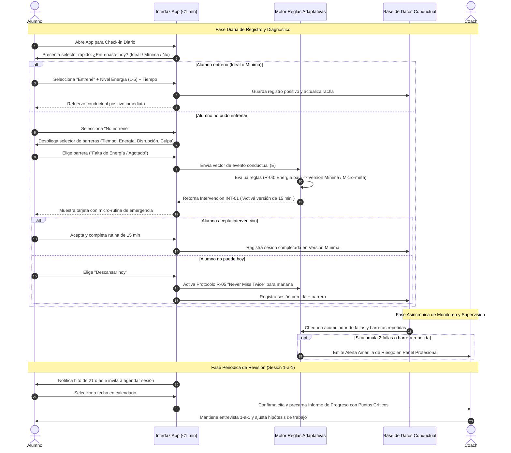
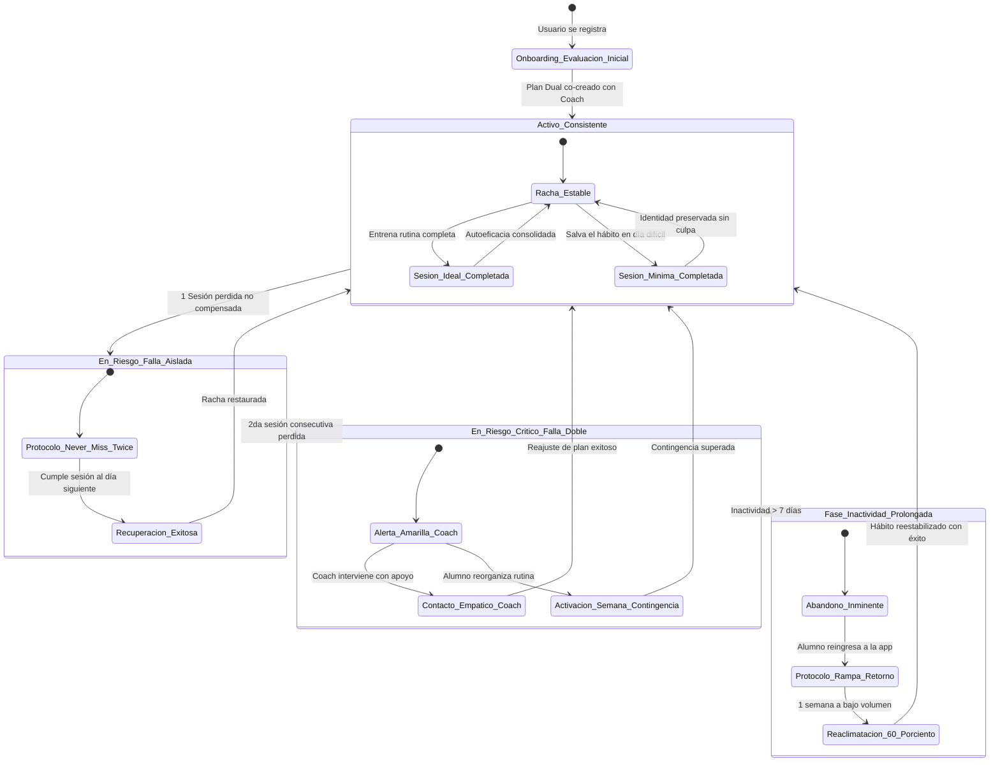
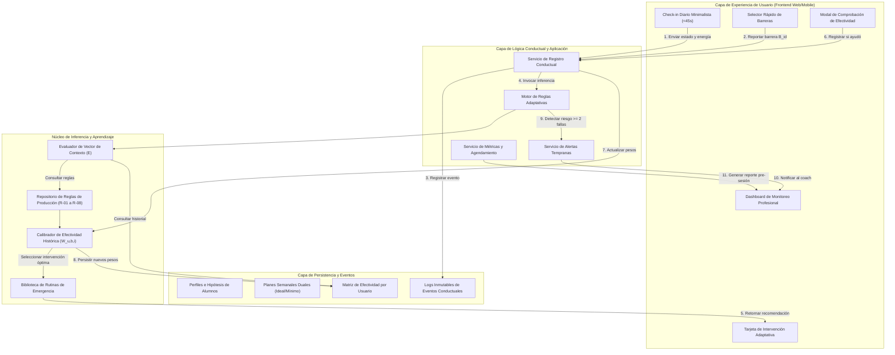

# Investigación y Estrategia Técnica: Diseño Conductual e Ingeniería de Requerimientos (R1 & R2)
**Ecosistema Entrenhábitos**  
*Documento de Análisis, Fundamentación Científica y Especificación de Software (SRS)*

---

## 1. Resumen Ejecutivo y Marco General

El presente documento constituye el informe técnico de investigación y diseño para los requerimientos **R1 (Diseño Conductual e Innovación de Producto)** y **R2 (Ingeniería de Requerimientos, SRS y Modelado Funcional)** del proyecto **Entrenhábitos**.

### 1.1. Diagnóstico de la Problemática
El 50% de las personas que inician un gimnasio lo abandonan durante los primeros seis meses. La literatura científica en ciencias del comportamiento demuestra que este fenómeno rara vez se debe a una falta de información técnica sobre ejercicios o nutrición. Por el contrario, obedece a un **fallo estructural en la gestión de barreras cotidianas**, agravado por:
1. La sobredependencia de picos volátiles de motivación extrínseca.
2. La rigidez de planes de entrenamiento binarios ("o entrenas 75 minutos o fallaste").
3. La distorsión cognitiva de "todo o nada" que convierte un contratiempo logístico en un abandono definitivo.

### 1.2. Propuesta de Valor y Enfoque Disruptivo de Entrenhábitos
Entrenhábitos redefine la categoría del entrenamiento personal al desplazar el foco desde el "rendimiento atlético abstracto" hacia la **"arquitectura de adherencia conductual"**.
Su promesa central —*«Descubrí qué te hace abandonar la rutina y construí un sistema para mantenerlo en tu vida»*— se materializa a través de un **modelo híbrido de acompañamiento 1-a-1** asistido por un **motor de reglas adaptativas**. La tecnología actúa como sensor de fricción diario (<1 minuto de registro) y generador de intervenciones inmediatas, mientras que el coach profesional aporta el juicio clínico, la alianza terapéutica y el ajuste estratégico en entrevistas periódicas.

---

## 2. R1: Análisis Crítico del Borrador y Diseño Conductual

### 2.1. Evaluación Crítica del Documento Fundacional (`Borrador Marca Personal Entrenhábitos.pdf`)

El documento fundacional sintetiza con lucidez el dolor real del usuario y propone 5 funciones operativas y 6 funcionalidades prioritarias. A continuación se evalúan sus fortalezas, brechas y oportunidades de innovación:

| Dimensión | Evaluación Crítica | Implicancia Técnica / Producto |
|---|---|---|
| **Concepto de Producto** | **Fortaleza**: Trata el abandono como un problema sistémico y no como un defecto moral del cliente. Enfoque preventivo y diagnóstico. | El software debe centrarse en métricas de regularidad y capacidad de retorno antes que en tonelaje levantado o calorías. |
| **5 Funciones Base** | **Fortaleza**: El bucle (1. Proponer rutina $\to$ 2. Detectar barrera $\to$ 3. Intervenir $\to$ 4. Comprobar efectividad $\to$ 5. Entrevista) es un ciclo cibernético de control conductual impecable. | Debe modelarse formalmente en el software como un bucle de retroalimentación cerrado con persistencia de efectividad histórica. |
| **Brecha 1: Definición de "Versión Mínima"** | **Brecha**: El borrador menciona "versión mínima de cada sesión para los días difíciles", pero no establece sus límites bioenergéticos ni psicológicos. | Debe parametrizarse como una sesión de 15 a 20 minutos con umbral de activación extremadamente bajo (2 ejercicios esenciales o movilidad). |
| **Brecha 2: Riesgo de Fatiga de Registro** | **Brecha**: Las apps de hábitos suelen fracasar porque el propio acto de registrar se convierte en una barrera más. | El check-in diario debe diseñarse para ser completado estrictamente en **menos de 45 segundos** con interacción de máximo 3 toques. |
| **Oportunidad: Resignificación de la Culpa** | **Oportunidad no explotada en el borrador**: Evitar la trampa del "castigo visual" (típico de apps con rachas que se ponen rojas o muestran caritas tristes). | Introducir microcopia empática y la regla conductual "Never Miss Twice" (No romper la cadena dos veces consecutivas). |

---

### 2.2. Articulación de Marcos Teóricos de Cambio de Comportamiento

Para transformar las intuiciones del borrador en una arquitectura tecnológica robusta, se integran cuatro marcos teóricos validados:

```
+----------------------------------------------------------------------------------------------------+
|                                    ECOSISTEMA CONDUCTUAL ENTRENHÁBITOS                            |
+----------------------------------------------------------------------------------------------------+
|  1. FOGG BEHAVIOR MODEL (B = MAP)                                                                  |
|     - Si M (Motivación) cae por cansancio -> Aumentar A (Habilidad/Simplicidad) vía Versión Mínima |
|     - Prompts adaptativos contextuales (Facilitadores en lugar de alarmas culpabilizantes)         |
+----------------------------------------------------------------------------------------------------+
|  2. HÁBITOS ATÓMICOS (James Clear)                                                                 |
|     - 1ª Ley: Señal (Hacerlo obvio) -> Horario ancla e intención de implementación                 |
|     - 2ª Ley: Deseo (Hacerlo atractivo) -> Foco en bienestar mental post-entreno                  |
|     - 3ª Ley: Respuesta (Hacerlo fácil) -> Regla de los 2 Minutos ("Solo llegar al gym")          |
|     - 4ª Ley: Recompensa (Hacerlo satisfactorio) -> "Never Miss Twice" + validación de esfuerzo    |
+----------------------------------------------------------------------------------------------------+
|  3. TEORÍA DE LA AUTODETERMINACIÓN (Deci & Ryan)                                                   |
|     - Autonomía: Co-diseño del plan dual (el usuario decide en tiempo real qué versión ejecutar)   |
|     - Competencia: Éxito garantizado en días malos mediante micro-metas realizables                |
|     - Relación: Acompañamiento 1-a-1 empático y validante por parte del coach                      |
+----------------------------------------------------------------------------------------------------+
|  4. TERAPIA COGNITIVO-CONDUCTUAL (Reestructuración del "Todo o Nada")                              |
|     - Erradicación del sesgo dicotómico: 15 min > 0 min ("Cualquier esfuerzo cuenta")             |
|     - Neutralización del "What-the-hell effect" tras una sesión perdida                            |
+----------------------------------------------------------------------------------------------------+
```

#### A. Fogg Behavior Model ($B = M \cdot A \cdot P$)
El modelo de BJ Fogg estipula que una conducta ocurre únicamente cuando convergen tres elementos simultáneos:
- **Motivación ($M$)**: Deseo o impulso interno/externo (altamente volátil, influido por estrés, sueño y dopamina).
- **Habilidad / Simplicidad ($A$)**: Capacidad física, mental, temporal y logística para realizar la acción.
- **Disparador / Prompt ($P$)**: La señal que llama a la acción.

**Regla de Oro en Entrenhábitos**: Cuando la Motivación ($M$) es baja (ej. un jueves lluvioso tras 10 horas de oficina), es fútil enviar notificaciones motivacionales exigiendo 60 minutos de sentadillas pesadas (el prompt cae por debajo de la línea de acción). La estrategia del motor de Entrenhábitos es **aumentar drásticamente la Simplicidad ($A$)** reduciendo el tiempo y esfuerzo a la **Versión Mínima Viable (15-20 min)**. De este modo, la conducta cruza la línea de acción incluso con niveles de motivación mínimos.

#### B. Hábitos Atómicos (Las 4 Leyes y Micro-hábitos)
1. **Hacerlo Obvio (Señal)**: En el plan semanal, cada sesión cuenta con un anclaje temporal y situacional explícito (Intención de Implementación de Peter Gollwitzer: *"Voy a entrenar los días [X] a las [Y] horas en [Gimnasio Z]"*).
2. **Hacerlo Atractivo (Deseo)**: Reencuadre del entrenamiento. En lugar de presentarlo como un peaje doloroso para conseguir estética a 6 meses, se enfatiza la recompensa dopaminérgica inmediata: claridad mental, reducción del cortisol y alivio de tensiones.
3. **Hacerlo Fácil (Respuesta - La Regla de los 2 Minutos)**: Ninguna rutina de inicio debe sentirse abrumadora. La app instrumentaliza la regla: *"El objetivo principal en días difíciles es presentarse"*. La micro-meta de entrada es ponerse la ropa deportiva y entrar al gimnasio durante 10 minutos; una vez superada la inercia estática, el 80% de los usuarios decide completar la sesión mínima o ideal.
4. **Hacerlo Satisfactorio (Recompensa - No Romper la Cadena Dos Veces)**: James Clear establece que saltarse un día es un accidente fortuito; saltarse dos días consecutivos es el comienzo de un nuevo hábito de inacción (*"Never miss twice"*). Si el usuario registra una sesión perdida el martes, el sistema prioriza como objetivo innegociable el entrenamiento del miércoles o jueves, activando proactivamente la versión mínima.

#### C. Teoría de la Autodeterminación (Self-Determination Theory - SDT)
La motivación intrínseca duradera descansa sobre tres necesidades psicológicas básicas:
- **Autonomía**: El usuario nunca recibe una rutina impuesta verticalmente. Define su plan junto al coach y mantiene la potestad cotidiana de elegir si activa la versión ideal o la mínima sin penalización.
- **Competencia**: El perfeccionismo tradicional genera fracaso crónico cuando las demandas de la vida chocan con la rutina. La versión mínima asegura que el usuario siempre mantenga un alto sentido de autoeficacia ("pude cumplir a pesar de las dificultades").
- **Relación / Conexión**: La presencia de un profesional real que revisa los patrones y no juzga las caídas genera la contención vincular indispensable para sostener el hábito a largo plazo.

#### D. Prevención del Sesgo Cognitivo "Todo o Nada"
El sesgo del "todo o nada" (pensamiento dicotómico) es el principal verdugo de la constancia: el usuario razona que *"si no puedo hacer la rutina completa de 70 minutos con todos los ejercicios y pesos habituales, entonces no tiene sentido ir"*. Esto detona el *What-the-hell effect* (efecto "¡qué más da!").
Entrenhábitos combate activamente este sesgo a nivel de interfaz y algoritmo mediante la premisa: **"15 minutos es infinitamente superior a 0 minutos"**. Un entrenamiento de emergencia no busca maximizar la ganancia muscular inmediata, sino preservar la identidad de la persona como deportista constante.

---

### 2.3. Estrategia Diferenciadora para los 5 Problemas de Abandono

A continuación se detalla cómo el método y software de Entrenhábitos supera los abordajes tradicionales para cada uno de los 5 problemas identificados en el borrador:

```
+----------------------------------------------------------------------------------------------------+
|                    MATRIZ DE RESOLUCIÓN PARA LOS 5 PROBLEMAS FRECUENTES                            |
+----------------------------------------------------------------------------------------------------+
| 1. Objetivos hiper-exigentes                                                                       |
|    - Abordaje Tradicional: "Mentalidad de año nuevo", planes de 5-6 días sin historial base.       |
|    - Solución Entrenhábitos: Onboarding con "Línea Base Sostenible". Planificar para la peor       |
|      semana del año, no para la mejor. Frecuencia inicial conservadora (ej. 2-3 días).             |
+----------------------------------------------------------------------------------------------------+
| 2. Dependencia de tener ganas o energía                                                            |
|    - Abordaje Tradicional: Charlas motivacionales, frases cliché, exigencia de fuerza de voluntad. |
|    - Solución Entrenhábitos: Desacoplamiento de la motivación. Diseño Dual (Ideal vs Mínima).     |
|      Si la energía autopercibida es <= 2/5, el sistema activa automáticamente la versión express.  |
+----------------------------------------------------------------------------------------------------+
| 3. Interpretación de sesión perdida como fracaso                                                   |
|    - Abordaje Tradicional: Rachas rotas que vuelven a cero, iconos de advertencia en rojo, culpa.  |
|    - Solución Entrenhábitos: Protocolo de "Reprogramación Sin Culpa" + "Never Miss Twice".         |
|      Las fallas son datos diagnósticos de barreras, no faltas morales. Próximo paso inmediato.    |
+----------------------------------------------------------------------------------------------------+
| 4. Dificultad para reorganizarse ante cambios de rutina                                            |
|    - Abordaje Tradicional: Desconcierto ante viajes, horas extra o exámenes. Abandono por bloqueo. |
|    - Solución Entrenhábitos: Módulo de "Semana de Contingencia". Reorganización en 2 clics:        |
|      desplazamiento de días, opción en casa o reducción transitoria de volumen sin romper el plan. |
+----------------------------------------------------------------------------------------------------+
| 5. Retomar repetidamente sin sostener (Efecto yo-yo)                                               |
|    - Abordaje Tradicional: Regresar tras un mes intentando levantar el mismo peso. Dolor extremo. |
|    - Solución Entrenhábitos: Protocolo de "Rampa de Retorno Progresivo". Semana de re-aclimatación|
|      al 60% de intensidad. Medición del Tiempo Medio de Retorno (MTTR - Mean Time to Recovery).    |
+----------------------------------------------------------------------------------------------------+
```

---

### 2.4. Catálogo Estructurado de Barreras y Matriz de Intervenciones Adaptativas

#### A. Las 5 Familias Principales de Barreras
1. **Familia B1 - Tiempo y Sobrecarga de Agenda**: Reuniones tardías, jornadas laborales extendidas, tareas domésticas imprevistas.
2. **Familia B2 - Fatiga Psicofísica y Baja Energía**: Mal descanso nocturno, agotamiento mental acumulado, estrés crónico.
3. **Familia B3 - Disrupción de Rutina y Cambios de Contexto**: Viajes de trabajo o placer, enfermedad leve, cierre de gimnasio por feriado, visitas familiares.
4. **Familia B4 - Fricción Logística y Operativa**: Gimnasio saturado de gente, condiciones climáticas adversas, no tener la mochila preparada, distancia/tráfico.
5. **Familia B5 - Bloqueo Emocional y Culpa ("Todo o Nada")**: Desmotivación tras una sesión perdida, sensación de incapacidad, vergüenza por haber interrumpido la racha.

#### B. Catálogo de Intervenciones Adaptativas Estandarizadas

| ID Intervención | Denominación | Descripción Operativa | Duración / Esfuerzo |
|---|---|---|---|
| **INT-01** | **Versión Mínima ("Día Difícil")** | Ejecución de 2 o 3 ejercicios multiarticulares clave (ej. Sentadilla en Prensa + Jalón al Pecho) o circuito de movilidad activa. Sin series al fallo. | 15 - 20 minutos |
| **INT-02** | **Micro-meta de Entrada (Regla 2 Min)** | Compromiso exclusivo de ponerse las zapatillas, trasladarse al gimnasio y hacer 5 minutos de caminata/calentamiento. Permiso explícito de retirarse si persiste el malestar. | 5 - 10 minutos |
| **INT-03** | **Reprogramación Inteligente Sin Culpa** | Traslado automático de la sesión no realizada al día siguiente o al fin de semana, verificando que no genere 3 días seguidos de sobrecarga. | 30 segundos (en app) |
| **INT-04** | **Entrenamiento Alternativo en Casa / Movilidad** | Rutina breve sin equipamiento en el domicilio (ej. sentadillas corporales, flexiones en pared/suelo, estiramientos y respiración). | 12 - 15 minutos |
| **INT-05** | **Protocolo "Never Miss Twice"** | Enfoque exclusivo en blindar la sesión inmediatamente posterior con recordatorio prioritario y micro-preparación logística previa. | 1 minuto (en app) |
| **INT-06** | **Rampa de Retorno Progresivo** | Tras 7+ días de inactividad, prescripción automática de 2 sesiones semanales al 60% del volumen habitual durante 7 días para evitar dolor muscular tardío (DOMS) desmotivante. | 1 semana |
| **INT-07** | **Ajuste de Horario / Ventana de Menor Fricción** | Cambio del entrenamiento de la noche a la mañana o mediodía para eludir la hora pico del gimnasio o el cansancio vespertino. | Variable |

#### C. Matriz de Inferencia Conductual: Barrera $\to$ Intervención $\to$ Mecanismo Psicológico

```
+-----------------------+--------------------------+-----------------------+-------------------------------+
| BARRERA DETECTADA     | CONDICIÓN DE CONTEXTO    | INTERVENCIÓN SUGERIDA | MECANISMO PSICOLÓGICO         |
+-----------------------+--------------------------+-----------------------+-------------------------------+
| B1: Falta de Tiempo   | Día laboral con agenda   | INT-01 (Versión Mín.) | Rompe la falacia "no tengo    |
|                       | saturada                 | de 15-20 min          | 1 hora, entonces no voy"      |
+-----------------------+--------------------------+-----------------------+-------------------------------+
| B2: Baja Energía /    | Nivel de energía <= 2/5  | INT-02 (Micro-meta) o | Reduce la fricción de inicio; |
|     Agotamiento       | y fatiga mental          | INT-01 (Versión Mín.) | activa la inercia conductual  |
+-----------------------+--------------------------+-----------------------+-------------------------------+
| B3: Disrupción /      | Usuario fuera de su      | INT-04 (Alternativa   | Mantiene la señal del hábito  |
|     Viaje / Cierre    | entorno habitual         | en Casa / Movilidad)  | sin dependencia de máquinas   |
+-----------------------+--------------------------+-----------------------+-------------------------------+
| B4: Fricción          | Gym colmado o clima      | INT-07 (Cambio hora)  | Evita la aversión al estrés   |
|     Logística         | hostil                   | o INT-04 (En casa)    | social y pérdida de tiempo    |
+-----------------------+--------------------------+-----------------------+-------------------------------+
| B5: Culpa / Bloqueo   | 1 o 2 sesiones perdidas  | INT-05 ("Never Miss   | Neutraliza el "What-the-hell  |
|     Todo o Nada       | consecutivas             | Twice") + INT-03      | effect" con auto-compasión    |
+-----------------------+--------------------------+-----------------------+-------------------------------+
| Inactividad > 7 días  | Retorno tras abandono    | INT-06 (Rampa de      | Evita el dolor extremo y      |
|                       | transitorio              | Retorno Progresivo)   | restaura la competencia       |
+-----------------------+--------------------------+-----------------------+-------------------------------+
```

#### D. Bucle de Validación de Efectividad
Para cumplir con la Función 4 del borrador (*"Comprobar si esa intervención ayudó"*), el sistema no asume el éxito. En el siguiente check-in diario, antes de pedir nuevos datos, el sistema formula una micro-pregunta:
> *"Ayer sugerimos activar la Versión Mínima ante tu falta de tiempo. ¿Te ayudó a sostener el hábito? [Sí, me sirvió / No me sirvió / No pude aplicarla]"*

Esta retroalimentación alimenta la variable de **Ponderación de Efectividad Histórica ($W_{u,b,i}$)** para ese usuario específico. Si a un usuario nunca le resulta reprogramar al día siguiente pero sí le funciona hacer 15 minutos en casa, el motor prioriza dicha intervención en futuras instancias.

---

## 3. R2: Especificación de Requerimientos de Software (SRS) y Modelado Funcional

### 3.1. Actores y Perfiles de Adherencia

#### A. Actores del Sistema
1. **Alumno / Entrenado**: Usuario final que interactúa a diario con la app para consultar su plan, registrar su check-in en <1 min, recibir recomendaciones adaptativas ante barreras y solicitar sesiones 1-a-1 con el coach.
2. **Coach / Profesional de Marca Personal**: Entrenador que co-diseña el plan, monitorea el panel con alertas predictivas de riesgo, analiza barreras recurrentes y conduce las sesiones estratégicas periódicas.
3. **Motor de Reglas Adaptativas (Submódulo Autónomo)**: Servicio lógico que procesa eventos de check-in, evalúa condiciones de contorno y prescribe intervenciones personalizadas inmediatas.
4. **Administrador de Plataforma (Proyección SaaS)**: Rol con capacidad de gestionar múltiples coaches, licencias y métricas agregadas del ecosistema.

#### B. Perfiles Iniciales de Adherencia (Generados en Onboarding)
A partir de la evaluación inicial, el sistema clasifica al usuario en un perfil preliminar con hipótesis operativas contrastables:

1. **Perfil A: El Perfeccionista Rígido ("Todo o Nada")**
   - *Rasgos*: Alta motivación inicial, fijación en marcas ideales, tendencia a frustrarse severamente y abandonar ante la primera falta.
   - *Hipótesis H1*: La introducción mandatoria de la versión mínima y la métrica de éxito basada en "salvar la semana" reducirá la tasa de abandono en las primeras 4 semanas en un 60%.
2. **Perfil B: El Agotado Crónico (Déficit de Energía)**
   - *Rasgos*: Jornadas laborales de alta demanda cognitiva, privación crónica de sueño. Falla típicamente entre martes y jueves.
   - *Hipótesis H2*: Presentar la opción de 15 minutos con bajo impacto neuromuscular en días de energía <= 2 aumentará la asistencia a 80% frente al 15% del plan tradicional.
3. **Perfil C: El Caótico / Impredecible**
   - *Rasgos*: Viajes frecuentes, horarios rotativos, imprevistos constantes de agenda.
   - *Hipótesis H3*: Proveer un botón de "Semana de Contingencia" y rutinas en casa sin equipamiento evitará la desconexión total durante periodos fuera de la ciudad.
4. **Perfil D: El Reiniciador Cíclico (Efecto Yo-Yo)**
   - *Rasgos*: Historial de más de 3 inicios fallidos en el último año. Empieza con entusiasmo desmedido y abandona en la semana 3 por sobreentrenamiento o desilusión.
   - *Hipótesis H4*: Restringir artificialmente la frecuencia a máximo 3 días y aplicar la Rampa de Retorno Progresivo estabilizará la retención más allá de los 90 días.

---

### 3.2. Catálogo Completo de Requerimientos Funcionales (18 RFs Detallados)

A continuación se especifican los 18 Requerimientos Funcionales que cubren e integran las 6 funcionalidades prioritarias del documento fundacional:

| ID | Nombre del Requerimiento | Actor | Descripción Funcional y Reglas Asociadas | Entrada / Datos | Salida / Resultado |
|---|---|---|---|---|---|
| **RF-01** | **Evaluación Inicial y Perfilado de Adherencia** | Alumno | El sistema presentará un cuestionario guiado de onboarding que evalúa historial de actividad, objetivos físicos, barreras pasadas, intentos previos y nivel de sobrecarga cotidiana. Al finalizar, asigna un arquetipo de adherencia e hipótesis de trabajo. | Respuestas del cuestionario (5-7 preguntas clave). | Perfil de Adherencia generado con hipótesis diagnóstica visible para el coach. |
| **RF-02** | **Co-creación del Plan Semanal Dual** | Alumno / Coach | El sistema permitirá configurar la frecuencia semanal (días previstos) y, para cada sesión, estructurar dos versiones: la **Versión Ideal** (ej. 45-60 min, 5-6 ejercicios) y la **Versión Mínima ("Día Difícil")** (15-20 min, 2-3 ejercicios esenciales). | Selección de días, ejercicios, series, repeticiones para ambas versiones. | Plan semanal activo con vista dual disponible para el alumno. |
| **RF-03** | **Check-in Diario Ultrarrápido (<1 minuto)** | Alumno | Interfaz minimalista de registro que permite declarar en un máximo de 3 toques: si entrenó (Versión Ideal o Versión Mínima) o si no entrenó; nivel de energía (1 a 5); y tiempo real empleado. | Toque en estado de sesión, selector de energía 1-5, slider de tiempo. | Registro diario consolidado en el historial con timestamp exacto. |
| **RF-04** | **Captura Guiada de Barreras Específicas** | Alumno | Si el usuario indica que no entrenó o que le costó mucho entrenar, la interfaz despliega inmediatamente una lista selectora de barreras predefinidas (Tiempo, Energía, Disrupción, Logística, Desmotivación) con opción de nota breve. | Selección de categoría de barrera y motivo específico. | Evento de barrera catalogado y remitido al motor de reglas adaptativas. |
| **RF-05** | **Motor de Recomendaciones Adaptativas en Vivo** | Sistema | Ante el registro de una sesión no realizada o reporte de barrera de energía/tiempo, el motor evalúa las reglas de decisión y despliega en tiempo real una recomendación conductual concreta (activar versión mínima, reprogramar sin culpa o rutina alternativa). | Evento de check-in, barrera reportada, historial previo del usuario. | Tarjeta de recomendación adaptativa en pantalla con acción de 1 clic. |
| **RF-06** | **Comprobación de Efectividad de la Intervención** | Alumno / Sistema | En el check-in posterior a una intervención prescrita, el sistema solicitará validar si la recomendación sugerida ayudó a sostener el hábito (Sí / No / Parcialmente), actualizando la ponderación histórica del usuario. | Evaluación cualitativa de efectividad (1 toque). | Actualización del índice de efectividad de la intervención ($W_{u,b,i}$). |
| **RF-07** | **Protocolo "Never Miss Twice"** | Sistema / Alumno | Si el sistema detecta que el usuario no entrenó en una sesión programada, el día siguiente se activa un estado de alerta preventiva que sugiere blindar la próxima sesión mediante la versión mínima y preparación de entorno. | Detección de sesión no realizada previa. | Notificación/Prompt de apoyo y destaque visual del plan de contingencia. |
| **RF-08** | **Módulo de Contingencia y Reorganización de Rutina** | Alumno / Coach | Funcionalidad que permite al alumno o coach activar el modo "Semana de Contingencia" (viaje laboral, exámenes, enfermedad) reorganizando la semana automáticamente sin penalizar las métricas de adherencia. | Parámetros del imprevisto (días afectados, limitación de equipamiento). | Cronograma semanal recalculado con versiones mínimas o rutinas en casa. |
| **RF-09** | **Protocolo de Rampa de Retorno Progresivo** | Sistema / Coach | Si el alumno acumula más de 7 días consecutivos de inactividad, el sistema bloquea temporalmente la versión ideal de alta intensidad y propone una semana de re-habituación al 60% de volumen para prevenir DOMS y deserción. | Contador de inactividad >= 7 días. | Prescripción automática de Rampa de Retorno con aprobación opcional del coach. |
| **RF-10** | **Panel de Seguimiento Profesional (Dashboard Coach)** | Coach | Vista integral para el entrenador que lista todos sus asesorados, clasificados por un semáforo de riesgo de abandono (Verde, Amarillo, Rojo), con métricas de ratio ideal vs. mínimo y sesiones completadas. | Filtros de búsqueda, ordenamiento por riesgo o fecha de última sesión. | Tabla/Tarjetas consolidadas de alumnos con indicadores clave de un vistazo. |
| **RF-11** | **Detección Automática de Barreras Recurrentes** | Sistema | Algoritmo que analiza el historial de los últimos 30 días e identifica si una barrera específica (ej. falta de tiempo los jueves) se repite >= 3 veces, marcándola como patrón crónico para tratamiento en sesión 1-a-1. | Historial agregado de barreras del alumno. | Alerta diagnóstica en el perfil del alumno con etiqueta de "Barrera Crónica". |
| **RF-12** | **Generador de Puntos Críticos para la Entrevista** | Sistema / Coach | El sistema compilará automáticamente una pauta de conversación para el coach antes de la sesión 1-a-1, destacando: barreras repetidas, intervenciones con baja efectividad y variación de energía. | Métricas agregadas del ciclo de entrenamiento del alumno. | Resumen ejecutivo con 3-4 preguntas estratégicas sugeridas para el coach. |
| **RF-13** | **Informe de Progreso y Salud del Hábito** | Alumno / Coach | Pantalla visual que presenta la consistencia semanal, el tiempo medio hasta retomar tras una pausa (MTTR), la distribución de sesiones ideales vs. mínimas y el índice de resiliencia del hábito. | Registros acumulados del periodo. | Gráficos de barra, tendencias de consistencia y balance de versiones de sesión. |
| **RF-14** | **Agendamiento Integrado de Sesión 1-a-1** | Alumno / Coach | Flujo que permite al alumno o coach abrir el calendario de disponibilidad del profesional para coordinar la entrevista de seguimiento, precargando automáticamente el informe de progreso reciente. | Selección de fecha y franja horaria disponible del coach. | Evento agendado con enlace a videoconferencia y ficha diagnóstica adjunta. |
| **RF-15** | **Biblioteca de Rutinas de Emergencia Parametrizables** | Coach | Repositorio de micro-rutinas (15-20 min) organizadas por grupo muscular o condición (en casa, gym saturado, movilidad de espalda) editables por el coach para asignación rápida. | Plantillas de ejercicios, tiempos de descanso e instrucciones en video/texto. | Catálogo de rutinas de emergencia disponible para el motor adaptativo. |
| **RF-16** | **Prompts Contextuales Respetuosos (Sin Spam)** | Sistema | Envío de notificaciones basadas estrictamente en la ventana temporal pactada por el alumno, con microcopia empática orientada a la acción y supresión automática si el usuario ya registró su sesión. | Ventana horaria configurada y estado de registro diario. | Notificación push/in-app oportuna y no invasiva. |
| **RF-17** | **Bitácora Clínica Privada del Coach** | Coach | Espacio de anotaciones cualitativas confidenciales donde el coach registra acuerdos tomados en la sesión 1-a-1, situaciones personales del alumno y ajustes a las hipótesis de trabajo. | Texto enriquecido, etiquetas y fecha de revisión acordada. | Historial cronológico de notas clínicas adjunto al expediente del alumno. |
| **RF-18** | **Trazabilidad y Auditoría de Eventos Conductuales** | Sistema | Registro inmutable de cada cambio de estado, barrera declarada, regla disparada e intervención ejecutada para análisis longitudinal y mejora del algoritmo. | Eventos del sistema con marca temporal y metadatos. | Log estructurado de eventos conductuales exportable para investigación. |

---

### 3.3. Requerimientos No Funcionales (RNFs Críticos)

| ID | Categoría | Requisito No Funcional | Métrica de Aceptación / Verificación |
|---|---|---|---|
| **RNF-01** | **Usabilidad y Fricción Temporal** | El flujo de check-in diario debe poder completarse en un tiempo promedio inferior a **45 segundos**, requiriendo un máximo de **3 toques/clics** en la pantalla principal. | Pruebas de usabilidad cronometradas en dispositivos móviles con usuarios en reposo y post-entreno ($t < 45s$). |
| **RNF-02** | **Rendimiento y Latencia del Motor** | El procesamiento de las reglas de decisión del motor adaptativo y la presentación de la recomendación en pantalla debe ejecutarse en menos de **200 milisegundos**. | Latencia medida en endpoint o función local de ejecución de reglas $\le 200ms$ al percentil 99 ($P99$). |
| **RNF-03** | **Privacidad y Protección de Datos** | Todos los datos de salud, historial de hábitos y notas clínicas deben almacenarse de forma cifrada (AES-256 en reposo, TLS 1.3 en tránsito) cumpliendo estándares de protección de datos (GDPR / Leyes locales de protección de datos personales). | Cifrado end-to-end verificado en auditoría de seguridad y políticas de retención y anonimización de datos. |
| **RNF-04** | **Escalabilidad y Transición a SaaS** | La arquitectura del software debe soportar desacoplamiento modular (Clean Architecture / Domain-Driven Design) de forma que el modelo actual 1-a-1 (un solo coach) pueda escalar a un modelo multi-coach / multi-tenant (SaaS B2C/B2B) sin reescribir la lógica de negocio. | Esquema de base de datos con aislamiento por `tenant_id` y `coach_id`; separación estricta entre capa de dominio, aplicación e infraestructura. |
| **RNF-05** | **Resiliencia y Funcionamiento Offline-First** | El alumno debe poder realizar su check-in diario o consultar su rutina en zonas con nula o deficiente cobertura móvil (ej. sótanos de gimnasios). Los datos se almacenan localmente y se sincronizan automáticamente al recuperar conectividad. | Persistencia en almacenamiento local (IndexedDB / SQLite local) con cola de sincronización bidireccional y resolución determinista de conflictos. |
| **RNF-06** | **Accesibilidad y Claridad Cognitiva** | La interfaz debe cumplir con las pautas **WCAG 2.1 Nivel AA**, ofreciendo un diseño de baja carga cognitiva, con tipografías legibles (mínimo 16px para cuerpo), contraste cromático ratio $\ge 4.5:1$ y modo visual de alta legibilidad para momentos de fatiga. | Validación automatizada con herramientas Lighthouse / Axe DevTools y verificación manual de contraste y navegación por teclado/lectores de pantalla. |

---

### 3.4. Historias de Usuario Detalladas (Formato Gherkin `Dado / Cuando / Entonces`)

#### HU-01: Registro diario ultrarrápido con versión mínima en día de alta fatiga
- **Como**: Alumno de Entrenhábitos con jornada laboral extenuante.
- **Quiero**: Registrar rápidamente que realicé la versión mínima de mi sesión en lugar de la ideal.
- **Para**: Mantener mi consistencia sin sentir culpa ni perder tiempo registrando detalles irrelevantes.
- **Criterio de Aceptación (Gherkin)**:
  ```gherkin
  Escenario: Registro exitoso de versión mínima en menos de 30 segundos
    Dado que soy un alumno autenticado con una sesión programada para hoy
    Y mi nivel de energía es bajo (2 sobre 5)
    Cuando abro la aplicación y selecciono la opción "Completé Versión Mínima"
    Y confirmo mi nivel de energía y el tiempo de 20 minutos
    Entonces el sistema registra la sesión como "Completada - Versión Mínima"
    Y actualiza mi racha de consistencia positivamente
    Y me muestra un mensaje de refuerzo conductual: "¡Excelente decisión! Salvaste el hábito en un día difícil."
  ```

#### HU-02: Activación inmediata de recomendación adaptativa ante barrera de tiempo
- **Como**: Alumno que no puede entrenar por una reunión imprevista.
- **Quiero**: Indicar que no puedo cumplir mi sesión ideal de 60 minutos por falta de tiempo.
- **Para**: Recibir una alternativa viable que me permita no abandonar el día por completo.
- **Criterio de Aceptación (Gherkin)**:
  ```gherkin
  Escenario: Disparo de regla de intervención ante barrera de tiempo
    Dado que tengo una sesión de fuerza programada para hoy
    Cuando ingreso al check-in y selecciono "No pude entrenar"
    Y elijo la barrera "Falta de Tiempo / Agenda Saturada"
    Entonces el motor de reglas adaptativas se ejecuta inmediatamente
    Y me presenta en pantalla la recomendación: "Versión de Emergencia de 15 min en casa o reprogramar para mañana"
    Y me permite aceptar la versión de 15 min con 1 solo toque, cargando la micro-rutina en mi pantalla.
  ```

#### HU-03: Protocolo "Never Miss Twice" tras una sesión perdida
- **Como**: Alumno que faltó a entrenar el día anterior.
- **Quiero**: Que la aplicación me ayude a enfocarme en la próxima sesión sin reproches ni penalizaciones.
- **Para**: Evitar caer en el sesgo de "todo o nada" y frenar la espiral de abandono.
- **Criterio de Aceptación (Gherkin)**:
  ```gherkin
  Escenario: Activación del protocolo preventivo de no romper la cadena dos veces
    Dado que el alumno no entrenó en su sesión programada previa
    Cuando abre la aplicación el día de hoy
    Entonces el sistema no muestra indicadores rojos ni mensajes de fracaso
    Y despliega la tarjeta de apoyo conductual: "Ayer no se pudo y es parte de la vida. Hoy protegemos la regla de oro: no faltar dos veces seguidas"
    Y pre-configura la sesión de hoy con la Versión Mínima como opción destacada por defecto.
  ```

#### HU-04: Onboarding, perfilado conductual e hipótesis inicial
- **Como**: Nuevo alumno que ingresa al servicio de Entrenhábitos.
- **Quiero**: Responder un cuestionario breve sobre mis antecedentes, frustraciones pasadas y estilo de vida.
- **Para**: Que el sistema y mi coach comprendan mis puntos ciegos antes de imponerme un plan.
- **Criterio de Aceptación (Gherkin)**:
  ```gherkin
  Escenario: Generación automática de perfil e hipótesis diagnóstica
    Dado que soy un usuario nuevo completando el onboarding inicial
    Cuando respondo las 6 preguntas sobre historial, barreras frecuentes y horarios
    Entonces el sistema categoriza mis respuestas bajo un arquetipo conductual (ej. "Perfeccionista Todo o Nada")
    Y genera una hipótesis de trabajo contrastable visible para el coach
    Y me presenta una bienvenida que valida mis dificultades previas.
  ```

#### HU-05: Co-creación y visualización del Plan Semanal Dual
- **Como**: Alumno junto con mi coach.
- **Quiero**: Disponer de un plan que contenga explícitamente una versión ideal y una versión mínima para cada día.
- **Para**: Saber con exactitud qué hacer cuando las cosas salgan perfectas y qué hacer cuando el día se complique.
- **Criterio de Aceptación (Gherkin)**:
  ```gherkin
  Escenario: Visualización interactiva del plan dual
    Dado que tengo un plan semanal acordado con mi coach
    Cuando accedo a la vista de "Mi Plan Semanal"
    Entonces visualizo claramente cada sesión con dos pestañas o selectores: "Versión Ideal (50 min)" y "Versión Día Difícil (15 min)"
    Y puedo alternar entre ambas para revisar ejercicios y recomendaciones operativas de cada una.
  ```

#### HU-06: Monitoreo en Panel Coach y Alerta Temprana de Abandono
- **Como**: Coach de Entrenhábitos.
- **Quiero**: Visualizar a mis asesorados ordenados por su nivel de riesgo de deserción en un panel central.
- **Para**: Proactivar un contacto o ajustar el plan antes de que el cliente abandone definitivamente.
- **Criterio de Aceptación (Gherkin)**:
  ```gherkin
  Escenario: Detección de riesgo de abandono y generación de alerta
    Dado que un alumno acumula 2 sesiones consecutivas no realizadas con barrera "Baja Energía"
    Cuando el coach ingresa al Panel de Seguimiento Profesional
    Entonces el alumno aparece resaltado en el semáforo con estado "Alerta Amarilla: Riesgo de Deserción"
    Y el sistema lista las barreras específicas reportadas y sugiere un mensaje de contacto empático.
  ```

#### HU-07: Feedback y aprendizaje sobre la efectividad de la intervención
- **Como**: Alumno que aceptó una intervención adaptativa el día anterior.
- **Quiero**: Informar al sistema si la alternativa sugerida me fue de utilidad real o no.
- **Para**: Que el algoritmo aprenda mis preferencias y refine sus futuras recomendaciones.
- **Criterio de Aceptación (Gherkin)**:
  ```gherkin
  Escenario: Registro de efectividad de la intervención
    Dado que ayer el sistema me recomendó reprogramar la sesión para hoy a las 8:00 AM
    Cuando realizo el check-in del día de hoy
    Entonces aparece la pregunta de validación: "¿Te sirvió la reprogramación propuesta ayer?"
    Y al pulsar "Sí, me sirvió", el sistema incrementa el peso de efectividad de esa intervención para mi perfil.
  ```

#### HU-08: Generación de Informe de Progreso y Agendamiento 1-a-1 Precargado
- **Como**: Alumno listo para su revisión periódica con el coach.
- **Quiero**: Generar un informe resumen de mis últimas semanas y abrir el calendario para agendar mi sesión.
- **Para**: Que la entrevista personalizada se base en datos conductuales objetivos y no en recuerdos difusos.
- **Criterio de Aceptación (Gherkin)**:
  ```gherkin
  Escenario: Agendamiento de sesión 1-a-1 con datos precargados
    Dado que han transcurrido 21 días desde el inicio del plan o la última entrevista
    Cuando accedo a la sección "Informe de Progreso"
    Entonces el sistema sintetiza mis métricas (tasa de adherencia, uso de versión mínima, barreras frecuentes)
    Y me ofrece el botón "Agendar Sesión 1-a-1 con mi Coach"
    Y al seleccionarlo, abre el calendario disponible vinculando el informe directamente a la cita del coach.
  ```

---

### 3.5. Especificación Lógica Formal del Motor de Reglas Adaptativas

El motor de reglas opera como un sistema de inferencia determinista basado en reglas de producción ($IF \to AND \to THEN \to VALIDATE$) enriquecido por una matriz de ponderaciones históricas.

#### A. Vector de Entrada ($E$)
Cada evento de check-in produce un vector estructurado:
$$E = \langle u_{id}, s_{status}, b_{id}, e_{level}, c_{consecutive\_misses}, t_{gap\_days}, w_{day\_of\_week} \rangle$$
Donde:
- $u_{id}$: Identificador único del alumno.
- $s_{status} \in \{\text{COMPLETED\_IDEAL}, \text{COMPLETED\_MINIMAL}, \text{MISSED}, \text{SKIPPED\_PLANNED}\}$.
- $b_{id} \in \{\text{NONE}, \text{B1\_TIME}, \text{B2\_ENERGY}, \text{B3\_ROUTINE\_DISRUPTION}, \text{B4\_LOGISTICS}, \text{B5\_GUILT\_ALL\_OR\_NOTHING}\}$.
- $e_{level} \in [1, 5]$: Nivel de energía autopercibida.
- $c_{consecutive\_misses} \in \mathbb{N}_0$: Número de sesiones fallidas consecutivas.
- $t_{gap\_days} \in \mathbb{N}_0$: Días transcurridos desde el último entrenamiento registrado.
- $w_{day\_of\_week} \in [1, 7]$: Día actual de la semana.

#### B. Tabla Formal de Reglas de Inferencia

```
+-------+-------------------------+---------------------------------+-----------------------------------+-----------------------------------+
| REGLA | CONDICIÓN PRIMARIA (IF) | CONTEXTO ADICIONAL (AND)        | INTERVENCIÓN GENERADA (THEN)      | MÉTRICA DE VALIDACIÓN (CHECK)     |
+-------+-------------------------+---------------------------------+-----------------------------------+-----------------------------------+
| R-01  | s_status = MISSED       | b_id = B1_TIME                  | Prescribir INT-01 (Versión Mínima | Check-in en t+1: ¿Se completó     |
|       |                         | AND time_remaining > 20 min     | Express de 15-20 min)             | sesión mínima ese mismo día?      |
+-------+-------------------------+---------------------------------+-----------------------------------+-----------------------------------+
| R-02  | s_status = MISSED       | b_id = B1_TIME                  | Prescribir INT-03 (Reprogramar a  | Check-in en t+1: ¿Se cumplió la   |
|       |                         | AND time_remaining <= 20 min    | ventana libre más próxima)        | sesión en el día reprogramado?    |
+-------+-------------------------+---------------------------------+-----------------------------------+-----------------------------------+
| R-03  | s_status = MISSED       | b_id = B2_ENERGY                | Prescribir INT-02 (Micro-meta de  | Check-in en t+1: ¿Asistió al gym  |
|       |                         | AND e_level <= 2                | Entrada: "Solo entrar 10 min")    | aunque sea a caminar/moverse?     |
+-------+-------------------------+---------------------------------+-----------------------------------+-----------------------------------+
| R-04  | s_status = MISSED       | b_id = B3_ROUTINE_DISRUPTION    | Prescribir INT-04 (Conversión a   | Check-in en t+1: ¿Ejecutó rutina  |
|       |                         | (viaje / feriado / imprevisto)  | Movilidad/Rutina en Casa 12 min)  | en casa sin aparatos?             |
+-------+-------------------------+---------------------------------+-----------------------------------+-----------------------------------+
| R-05  | s_status = MISSED       | c_consecutive_misses = 1        | Disparar Protocolo INT-05         | Tasa de retorno en t+1: ¿Se evitó |
|       |                         | (Primera falta de la semana)    | ("Never Miss Twice" sin culpa)    | la segunda falta consecutiva?     |
+-------+-------------------------+---------------------------------+-----------------------------------+-----------------------------------+
| R-06  | s_status = MISSED       | c_consecutive_misses >= 2       | Emitir Alerta Amarilla al Coach   | Tiempo de contacto del coach      |
|       |                         |                                 | + Activar diálogo empático en app | y resolución de barrera en app.   |
+-------+-------------------------+---------------------------------+-----------------------------------+-----------------------------------+
| R-07  | s_status = MISSED       | t_gap_days >= 7                 | Disparar INT-06 (Rampa de Retorno | Tasa de finalización de la        |
|       |                         | (Inactividad prolongada)        | Progresivo al 60% de volumen)     | primera semana de reingreso.      |
+-------+-------------------------+---------------------------------+-----------------------------------+-----------------------------------+
| R-08  | count(b_id) >= 3 en     | Misma barrera repetida en 30 d  | Marcar "Barrera Crónica" y        | Discusión efectiva y acuerdo      |
|       | últimos 30 días         |                                 | generar tarjeta para entrevista   | registrado en notas del coach.    |
+-------+-------------------------+---------------------------------+-----------------------------------+-----------------------------------+
```

#### C. Bucle de Aprendizaje y Ponderación de Efectividad ($W_{u,b,i}$)
Para cada usuario $u$, barrera $b$ e intervención $i$, el sistema almacena un peso de efectividad $W_{u,b,i} \in [0.1, 1.0]$, inicializado en $0.5$.
Tras cada validación en el check-in posterior:
- Si el alumno responde "Sí, me sirvió":
  $$W_{u,b,i} \leftarrow \min(1.0, W_{u,b,i} + 0.15)$$
- Si el alumno responde "No me sirvió":
  $$W_{u,b,i} \leftarrow \max(0.1, W_{u,b,i} - 0.20)$$
Cuando se disparan múltiples intervenciones candidatas para una barrera, el motor selecciona la intervención con mayor $W_{u,b,i}$, garantizando que el sistema aprenda de la conducta empírica del sujeto y no de supuestos estáticos.

---

### 3.6. Arquitectura de Diagramas Mermaid

#### Diagrama 1: Flujo de Interacción Integral (Alumno $\leftrightarrow$ Sistema Adaptativo $\leftrightarrow$ Coach)



---

#### Diagrama 2: Máquina de Estados Finitos de Adherencia del Alumno



---

#### Diagrama 3: Arquitectura de Componentes y Flujo de Datos del Motor Adaptativo



---

## 4. Matriz de Trazabilidad Integral

Esta matriz vincula biunívocamente cada elemento del documento fundacional (`Borrador Marca Personal Entrenhábitos.pdf`) con los requerimientos técnicos y componentes del sistema:

| Problema / Función del Borrador | Funcionalidad Prioritaria del Borrador | Requerimiento Funcional (RF) | Regla del Motor Adaptativo | Componente de Interfaz / Prototipo |
|---|---|---|---|---|
| **Problema 1**: Empiezan con objetivos demasiado exigentes | **Funcionalidad 1**: Evaluación Inicial | **RF-01**: Evaluación Inicial y Perfilado de Adherencia | Inferencia de Arquetipo e Hipótesis de Trabajo | Flujo de Onboarding / Cuestionario interactivo con asignación de perfil |
| **Función 1**: Proponer rutina en base a objetivos físicos | **Funcionalidad 2**: Plan Semanal Realista | **RF-02**: Co-creación del Plan Semanal Dual | Parametrización de versión mínima obligatoria | Pantalla "Plan Semanal" con selector de vista Ideal vs. Día Difícil |
| **Problema 2**: Dependen de tener ganas o energía | **Funcionalidad 3**: Registro Breve Diario (<1 min) | **RF-03**: Check-in Diario Ultrarrápido | Umbral de activación por energía $e_{level} \le 2$ | Widget de Check-in en Home con selector de 3 estados y deslizador de energía |
| **Función 2**: Detectar barreras para no entrenar | **Funcionalidad 3**: Registro Breve Diario | **RF-04**: Captura Guiada de Barreras Específicas | Mapeo a catálogo de 5 familias de barreras | Modal táctil de selección de barrera con iconos claros |
| **Problema 3**: Sesión perdida interpretada como fracaso | **Funcionalidad 4**: Recomendaciones Adaptativas | **RF-05** y **RF-07**: Motor de Recomendaciones y Protocolo "Never Miss Twice" | Regla R-05: Disparo de intervención sin culpa ante primera falta | Tarjeta de Refuerzo Empático con botón de reprogramación automática |
| **Función 3**: Proponer intervención según barrera | **Funcionalidad 4**: Recomendaciones Adaptativas | **RF-05**: Motor de Recomendaciones Adaptativas | Reglas R-01 a R-04: Asignación de intervención según barrera | Tarjeta de Acción Inmediata: Rutina Express de 15 min precargada |
| **Función 4**: Comprobar si esa intervención ayudó | **Funcionalidad 4**: Recomendaciones Adaptativas | **RF-06**: Comprobación de Efectividad | Bucle de actualización de pesos bayesianos $W_{u,b,i}$ | Pregunta de micro-validación en el check-in del día posterior |
| **Problema 4**: Dificultad para reorganizarse ante cambios | **Funcionalidad 2**: Plan Semanal Realista | **RF-08**: Módulo de Contingencia y Reorganización | Regla R-04: Adaptación ante disrupción de contexto | Botón "Activar Modo Contingencia" para reacomodar días de la semana |
| **Problema 5**: Retomar repetidamente sin sostener | **Funcionalidad 4**: Recomendaciones Adaptativas | **RF-09**: Rampa de Retorno Progresivo | Regla R-07: Inactividad $\ge 7$ días bloquea sobrecarga | Banner de re-aclimatación al 60% de volumen para proteger articulaciones |
| **Función 5**: Entrevista personalizada con diagnóstico | **Funcionalidad 5**: Panel de Seguimiento Profesional | **RF-10**, **RF-11**, **RF-12**: Dashboard Coach y Detección de Barreras | Regla R-06 y R-08: Alertas de deserción y barreras crónicas | Vista Coach: Semáforo de riesgo, tabla de asesorados y puntos para la sesión |
| **Función 5**: Registro de datos y apertura de calendario | **Funcionalidad 6**: Informe de Progreso y Agendamiento | **RF-13**, **RF-14**: Informe de Progreso y Agendamiento 1-a-1 | Generación de resumen para cita periódica de 21 días | Vista Alumno: Informe visual de adherencia + Modal integrado de agendamiento |

---

## 5. Conclusiones y Recomendaciones de Implementación

1. **Prioridad Absoluta a la Cero Fricción en el Registro**: El éxito conductual de Entrenhábitos radica en que el usuario no sienta el check-in como una tarea burocrática. Debe limitarse estrictamente a 3 toques y menos de 45 segundos.
2. **La Versión Mínima como Escudo de Autoeficacia**: La versión mínima (15-20 min) no es una alternativa de segunda categoría; es la piedra angular que sostiene la identidad deportiva del usuario en sus momentos de crisis. El software debe celebrarla con el mismo entusiasmo que una sesión ideal.
3. **El Motor Adaptativo como Asistente Clínico del Coach**: La tecnología no reemplaza la empatía ni el criterio del entrenador de marca personal; por el contrario, lo libera del trabajo manual y le provee datos objetivos de conducta para transformar la entrevista 1-a-1 en un diálogo de alto impacto conductual.
4. **Viabilidad Inmediata para el Prototipo (R4)**: Las especificaciones funcionales, diagramas y tablas de inferencia detalladas en este reporte proveen la arquitectura directa para construir el prototipo interactivo sin ambigüedades, con trazabilidad completa de cada componente.
