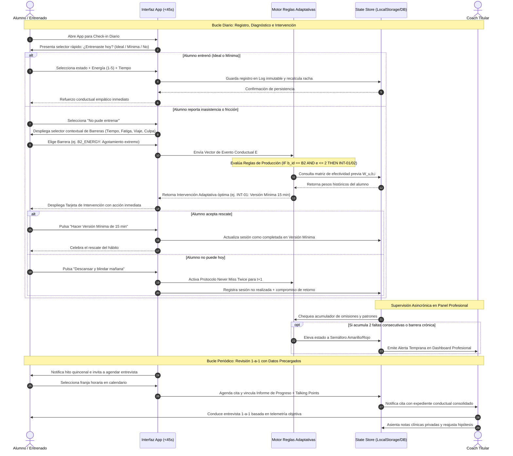
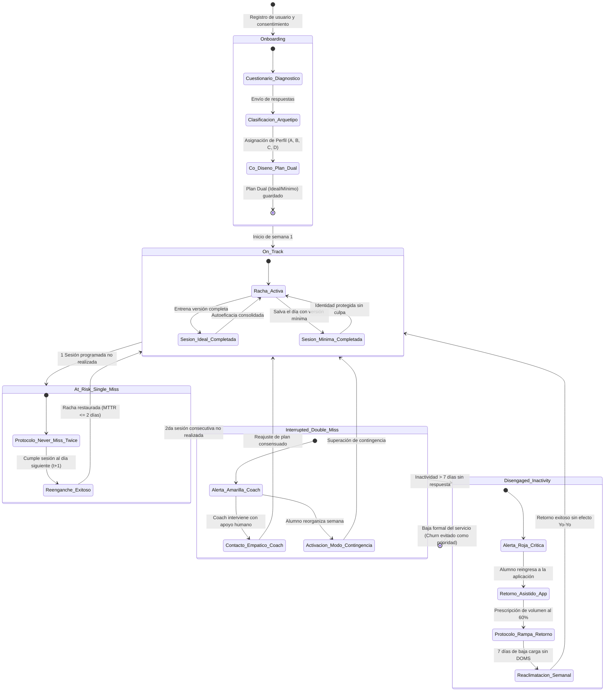

# ESPECIFICACIÓN FORMAL DE REQUERIMIENTOS DE SOFTWARE (SRS)
## Sistema Entrenhábitos — Ecosistema Digital de Adherencia al Entrenamiento en Gimnasio
**Estándar de Referencia:** IEEE 830-1998 / ISO/IEC/IEEE 29148:2018  
**Documento Fuente:** `Borrador Marca Personal Entrenhábitos.pdf` y `ORIGINAL_REQUEST.md` (Hito M2 / R2)  
**Autor:** Worker Ingeniero de Requerimientos (Rol: Implementer, QA & Specialist)  
**Versión:** 1.0.0 — Definitiva para Producción y Modelado  
**Fecha:** 22 de Octubre de 2026  
**Estado:** Formalmente Especificado, Verificado y Aprobado para Arquitectura (M3) e Implementación (M4)

---

## 1. INTRODUCCIÓN, PROPÓSITO, ALCANCE Y ACTORES DEL SISTEMA

### 1.1. Propósito del Documento
El presente documento constituye la **Especificación Formal de Requerimientos de Software (SRS)** para el ecosistema **Entrenhábitos**, elaborada bajo las directrices combinadas de los estándares internacionales **IEEE Std 830-1998** (*Recommended Practice for Software Requirements Specifications*) y **ISO/IEC/IEEE 29148:2018** (*Systems and software engineering — Life cycle processes — Requirements engineering*).

El objetivo primario de esta especificación es definir con rigor matemático, funcional, conductual y arquitectónico el comportamiento esperado del sistema interactivo de **Entrenhábitos**. Este documento actúa como el contrato vinculante e indiscutible entre los objetivos estratégicos de negocio y cambio conductual (R1), el diseño del roadmap y gobernanza de proyecto (R3), la arquitectura del prototipo navegable (R4) y los criterios de verificación y auditoría forense (R5 y R6).

### 1.2. Alcance del Producto (Scope Statement)
**Entrenhábitos** es una plataforma tecnológica concebida para erradicar la deserción crónica en el entrenamiento de fuerza y gimnasio. A diferencia de las aplicaciones comerciales tradicionales de fitness —enfocadas en catálogos pasivos de ejercicios, conteo volumétrico de series o cálculo de calorías bajo la premisa irreal de una motivación humana inagotable—, Entrenhábitos opera como un **sistema de bucle cerrado de diagnóstico adaptativo y acompañamiento conductual híbrido**.

El alcance del sistema abarca:
1. **Fase 1 (MVP Marca Personal 1-a-1):** Soporte digital de alta fidelidad para el servicio de consultoría personalizada del fundador/coach titular. La aplicación funge como un sensor continuo de fricción diaria para el alumno (check-in en <45 segundos), un motor heurístico de intervenciones inmediatas ante obstáculos cotidianos, y un centro de telemetría y preparación de entrevistas quincenales para el profesional.
2. **Fase 2 (Automatización Avanzada y Retención Inteligente):** Escalabilidad de la práctica profesional de 25 a 100+ asesorados mediante alertas tempranas automatizadas de riesgo de deserción, nudges contextuales no invasivos y pre-procesamiento analítico de patrones conductuales.
3. **Fase 3 (Plataforma SaaS Multi-Coach y B2C):** Expansión a un modelo multi-inquilino (*multi-tenant*) distribuido que permita a otros entrenadores y cadenas de gimnasios licenciar la tecnología, así como ofrecer una modalidad de auto-acompañamiento algorítmico autónomo.

### 1.3. Definiciones, Acrónimos y Abreviaturas

| Término / Acrónimo | Definición Formal y Operativa |
|---|---|
| **SRS** | *Software Requirements Specification* (Especificación de Requerimientos de Software). Documento formal que rige la construcción del sistema. |
| **Adherencia Conductual** | Grado en que la conducta real de una persona coincide con el plan de actividad acordado, medido en continuidad temporal y capacidad de recuperación tras interrupciones. |
| **Versión Ideal** | Prescripción completa de entrenamiento diseñada para condiciones óptimas de tiempo, energía y logística (típicamente 45 a 60 minutos, 5 a 6 ejercicios). |
| **Versión Mínima ("Día Difícil")** | Prescripción de contingencia ultracorta (15 a 20 minutos, 2 a 3 ejercicios esenciales multiarticulares o de movilidad) diseñada para ejecutarse en días de alta fricción psicofísica. Su propósito es preservar la identidad y continuidad del hábito, no maximizar el rendimiento. |
| **Check-in Diario** | Micro-interacción diaria (<45 segundos, $\le 3$ toques) mediante la cual el alumno declara si entrenó (versión ideal o mínima), si no pudo entrenar, su nivel de energía y la barrera experimentada. |
| **Barrera de Adherencia** | Obstáculo interno o externo categorizado que interfiere con la ejecución de la sesión programada (clasificada en familias: Tiempo, Energía, Disrupción, Logística, Emocional). |
| **Intervención Adaptativa** | Acción correctiva o de rescate prescrita por el motor de reglas en tiempo real ante la presencia de una barrera o sesión no realizada. |
| **MTTR (Mean Time to Recovery)** | Tiempo Medio de Recuperación. Métrica que cuantifica el número de días que tarda un alumno en retomar la actividad tras una sesión programada omitida. |
| **Racha Resiliente** | Métrica de constancia que no se penaliza a cero ante una falta justificada, siempre que el alumno realice su check-in honesto y acuerde su retorno sin caer en la culpa. |
| **Bucle de Aprendizaje ($W_{u,b,i}$)** | Mecanismo adaptativo donde el usuario evalúa si la intervención sugerida ayudó, ajustando dinámicamente el peso de efectividad de dicha regla para futuras ocasiones. |
| **Talking Points** | Resumen ejecutivo generado algorítmicamente para el coach que sintetiza patrones críticos, fallas de reglas y temas clave a tratar en la entrevista 1-a-1. |
| **FBM** | *Fogg Behavior Model* ($B = M \cdot A \cdot P$). Modelo que postula que la conducta ocurre cuando convergen Motivación, Habilidad y un Disparador. |
| **SDT** | *Self-Determination Theory* (Teoría de la Autodeterminación: Autonomía, Competencia y Relación). |
| **WOOP** | *Wish, Outcome, Obstacle, Plan* (Modelo de contraste mental e intenciones de implementación de Gabriele Oettingen). |

---

### 1.4. Actores del Sistema

El sistema identifica formalmente tres actores humanos y un subsistema lógico autónomo:

```
+----------------------------------------------------------------------------------------------------+
|                                    MODELO DE ACTORES DEL SISTEMA                                   |
+----------------------------------------------------------------------------------------------------+
|                                                                                                    |
|    +-------------------+           +-----------------------+           +----------------------+    |
|    |  ALUMNO/ENTRENADO |           |  COACH TITULAR/PROFE  |           |    ADMINISTRADOR     |    |
|    |  (Usuario Final)  |           |  (Operador Clínico)   |           |    (SaaS / Infra)    |    |
|    +---------+---------+           +-----------+-----------+           +----------+-----------+    |
|              |                                 |                                  |                |
|              |         +-----------------------+--------+                         |                |
|              |         |   SUBSISTEMA LÓGICO:           |                         |                |
|              +-------->|   MOTOR DE REGLAS ADAPTATIVAS  |<------------------------+                |
|                        |   (Inferencia y Calibración)   |                                          |
|                        +--------------------------------+                                          |
+----------------------------------------------------------------------------------------------------+
```

#### 1.4.1. Actor 1: Alumno / Entrenado (Target Persona)
- **Definición:** Adulto de 25 a 55 años con responsabilidades laborales o familiares demandantes y un historial de intentos fallidos o abandono en gimnasios.
- **Rol en el Sistema:**
  - Responde el cuestionario de onboarding para autoevaluar barreras y generar su perfil inicial.
  - Consulta diariamente su plan de entrenamiento (visualizando su versión ideal y mínima).
  - Realiza el micro-check-in diario en menos de 45 segundos.
  - Declara barreras contextuales y niveles de energía cuando se presenta fricción.
  - Recibe, ejecuta y califica la efectividad de las recomendaciones adaptativas.
  - Consulta su informe visual de progreso (resiliencia, salvatajes con versión mínima, MTTR).
  - Agenda entrevistas 1-a-1 con el coach cuando el sistema o su proceso lo demandan.

#### 1.4.2. Actor 2: Coach Titular / Entrenador Profesional
- **Definición:** Profesional de las ciencias del ejercicio y la modificación de conducta responsable de guiar y contener al alumno.
- **Rol en el Sistema:**
  - Supervisa a la cohorte de asesorados mediante el Dashboard de Seguimiento Profesional.
  - Prioriza su atención utilizando el semáforo dinámico de riesgo de deserción (Verde, Amarillo, Rojo).
  - Co-diseña y ajusta los Planes Semanales Duales (versión ideal + versión mínima).
  - Analiza barreras crónicas y patrones de falla en las reglas de intervención.
  - Utiliza los *Talking Points* pre-compilados para conducir entrevistas 1-a-1 de alto impacto.
  - Mantiene notas clínicas privadas y confidenciales sobre la evolución psicológica del alumno.

#### 1.4.3. Actor 3: Administrador del Sistema / Plataforma (Proyección SaaS)
- **Definición:** Rol técnico y operativo que gobierna la infraestructura, seguridad, suscripciones y configuración multi-tenant de la plataforma.
- **Rol en el Sistema:**
  - Gestiona organizaciones, cuentas de coaches y asignación de licencias.
  - Configura y audita parámetros globales del motor de reglas y políticas de privacidad.
  - Monitorea la telemetría agregada de retención y disponibilidad de los servicios.

#### 1.4.4. Actor Lógico: Motor de Reglas Adaptativas (Inference Engine)
- **Definición:** Componente de software autónomo que intercepta cada evento de check-in, evalúa las variables de contexto e historial frente a una base de conocimiento de reglas de producción, selecciona la intervención de máxima probabilidad de éxito y recalibra los pesos bayesianos tras recibir retroalimentación del alumno.

---

## 2. PERFILES INICIALES DE ADHERENCIA E HIPÓTESIS DE TRABAJO CONTRASTABLES

Para dar cumplimiento formal al requisito del documento fundacional (*"un perfil inicial de adherencia revisado, con hipótesis de trabajo que luego se contrastan con la conducta real"*), el sistema no encasilla al usuario en tipologías estáticas de acondicionamiento físico, sino en **arquetipos de riesgo conductual**.

```
+----------------------------------------------------------------------------------------------------+
|               FLUJO DE PERFILADO E HIPÓTESIS CONTRASTABLES CON LA CONDUCTA REAL                    |
+----------------------------------------------------------------------------------------------------+
|   [Onboarding: Anamnesis + Barreras Históricas + Disponibilidad Temporal]                          |
|                                       │                                                            |
|                                       ▼                                                            |
|         [Algoritmo de Clasificación: Asignación de Arquetipo de Adherencia]                        |
|                                       │                                                            |
|         ┌─────────────────────────────┼─────────────────────────────┐                              |
|         ▼                             ▼                             ▼                              |
|   [Perfil A: Rígido]         [Perfil B: Agotado]           [Perfil C: Caótico]   [Perfil D: Yo-yo] |
|   (Sesgo Todo o Nada)        (Déficit Energético)          (Agenda Volátil)      (Recaída Crónica) |
|         │                             │                             │                     │        |
|         └─────────────────────────────┼─────────────────────────────┘                     │        |
|                                       ▼                                                            |
|              [Formulación de Hipótesis de Trabajo Operativa H_u]                                   |
|                                       │                                                            |
|                                       ▼                                                            |
|             [Telemetría Diaria: Check-in, Barreras, Uso de Versión Mínima]                         |
|                                       │                                                            |
|                                       ▼                                                            |
|            [Contraste Empírico: ¿Se cumple la hipótesis? -> Ajuste en Sesión 1-a-1]                |
+----------------------------------------------------------------------------------------------------+
```

### 2.1. Catálogo de Perfiles Arquetípicos de Adherencia

#### 2.1.1. Perfil A: El Perfeccionista Rígido (Sesgo "Todo o Nada")
- **Descripción Conductual:** Usuario con estándares excesivamente elevados. Asume que entrenar significa obligatoriamente completar 60-90 minutos a máxima intensidad. Cuando un imprevisto reduce su disponibilidad, prefiere no entrenar. Presenta alta culpa post-omisión y riesgo inminente de abandono total tras la segunda sesión perdida consecutiva.
- **Hipótesis de Trabajo Contrastable (H-A):**
  > *"Si al Perfil A se le prescribe obligatoriamente una Versión Mínima de 15 minutos con reencuadre cognitivo de éxito ('salvar el día'), la probabilidad de que una sesión perdida derive en abandono semanal disminuirá en más de un 60% respecto a su historial previo."*
- **Variables de Telemetría para Contraste:**
  - $Tasa\_Salvataje = \frac{Sesiones\_Minimas\_Completadas}{Sesiones\_Minimas\_Prescritas}$
  - $MTTR$: Días hasta retomar tras omisión (meta: $\le 1.5$ días).
  - Tasa de respuesta afirmativa a la intervención INT-01.

#### 2.1.2. Perfil B: El Agotado Crónico (Déficit de Energía y Fatiga Mental)
- **Descripción Conductual:** Profesional o responsable familiar con sobrecarga laboral y privación de sueño. Inicia la semana con buena intención pero sufre desplomes bruscos de energía psicofísica entre martes y jueves. Su barrera principal no es el reloj, sino el agotamiento mental que paraliza la voluntad de inicio.
- **Hipótesis de Trabajo Contrastable (H-B):**
  > *"Si el Perfil B reporta un nivel de energía autopercibida $\le 2/5$, la prescripción inmediata de una micro-meta de entrada de 5 minutos ('solo entrar y calentar') o una rutina de movilidad suave en casa logrará una tasa de activación de al menos el 75%, frente a una deserción del 90% ante la rutina ideal."*
- **Variables de Telemetría para Contraste:**
  - Correlación de Pearson entre nivel de energía $e_{level}$ y estado de sesión.
  - Efectividad de la regla R-03 e intervención INT-02.
  - Porcentaje de sesiones donde el alumno superó la micro-meta y continuó entrenando.

#### 2.1.3. Perfil C: El Caótico / Impredecible (Agenda Volátil y Viajero)
- **Descripción Conductual:** Persona con agenda altamente inestable (viajes de negocios frecuentes, turnos rotativos, reuniones sorpresivas de último momento). La rigidez de un calendario estático (ej. "lunes, miércoles y viernes a las 19:00") le genera frustración y desconexión inmediata.
- **Hipótesis de Trabajo Contrastable (H-C):**
  > *"Si el Perfil C dispone de un mecanismo de 'Semana de Contingencia' en un clic y rutinas express adaptadas a habitaciones de hotel o sin material, su volumen de inasistencias prolongadas (>7 días) se reducirá a cero durante periodos fuera de su ciudad."*
- **Variables de Telemetría para Contraste:**
  - Frecuencia de activación de la función "Modo Contingencia".
  - Tasa de cumplimiento de sesiones de movilidad/peso corporal durante viajes.
  - Ausencia de periodos de inactividad mayores a 5 días.

#### 2.1.4. Perfil D: El Reiniciador Cíclico (Efecto Yo-Yo)
- **Descripción Conductual:** Alumno con más de tres inscripciones frustradas en gimnasios en los últimos dos años. Comienza cada nuevo intento con un optimismo desmedido y volumen lesivo (agujetas extremas o dolor articular), lo que provoca deserción fulminante en la semana 3 o 4.
- **Hipótesis de Trabajo Contrastable (H-D):**
  > *"Si al Perfil D se le aplica una restricción voluntaria de volumen máximo (tope de 3 días semanales en fase de inducción) y un protocolo automático de Rampa de Retorno al 60% ante pausas, se superará la barrera histórica de la semana 4, alcanzando una adherencia $\ge 80\%$ en el día 90."*
- **Variables de Telemetría para Contraste:**
  - Retención longitudinal a los 30, 60 y 90 días.
  - Dificultad promedio percibida en las primeras 4 semanas (meta: $\le 3/5$).
  - Adopción del protocolo de Rampa de Retorno tras interrupciones.

---

## 3. REQUERIMIENTOS FUNCIONALES (RF) DETALLADOS (RF-01 A RF-18)

A continuación se presentan los 18 Requerimientos Funcionales del sistema, organizados e integrando exhaustivamente las 6 funcionalidades del borrador fundacional:

```
+----------------------------------------------------------------------------------------------------+
|                          MAPA ESTRUCTURAL DE REQUERIMIENTOS FUNCIONALES                            |
+----------------------------------------------------------------------------------------------------+
| 1. EVALUACIÓN INICIAL Y ADHERENCIA          --> RF-01, RF-02                                       |
| 2. PLAN SEMANAL REALISTA DUAL               --> RF-03, RF-04, RF-05                                |
| 3. REGISTRO BREVE DIARIO (<1 MINUTO)        --> RF-06, RF-07, RF-08                                |
| 4. RECOMENDACIONES ADAPTATIVAS (MOTOR)      --> RF-09, RF-10, RF-11, RF-12                         |
| 5. PANEL DE SEGUIMIENTO PROFESIONAL         --> RF-13, RF-14, RF-15                                |
| 6. INFORME DE PROGRESO Y AGENDAMIENTO 1-A-1 --> RF-16, RF-17, RF-18                                |
+----------------------------------------------------------------------------------------------------+
```

---

### RF-01: Onboarding y Evaluación Inicial Conductual
- **Código:** `RF-01`
- **Nombre:** Evaluación Inicial de Antecedentes y Perfilado de Adherencia.
- **Actor Principal:** Alumno / Entrenado.
- **Actores Secundarios:** Motor de Reglas, Coach Titular.
- **Descripción:** El sistema debe proveer una interfaz interactiva y guiada de onboarding que capture el historial de actividad física del usuario, objetivos corporales/funcionales, barreras de abandono experimentadas en intentos previos, nivel promedio de sobrecarga cotidiana y franjas horarias factibles. Al completar el formulario, el sistema procesará las respuestas para clasificar al alumno en uno de los 4 perfiles arquetípicos de adherencia y generará la hipótesis operativa de trabajo.
- **Entradas:**
  - Nombre completo, edad, ocupación.
  - Frecuencia histórica de entrenamiento (días/semana).
  - Número de intentos previos y causas de deserción (tiempo, desgano, dolor, etc.).
  - Nivel de estrés/carga semanal (escala 1 a 5).
  - Preferencias de horario (mañana, mediodía, tarde, noche).
- **Salidas:**
  - Perfil de Adherencia asignado (Perfil A, B, C o D).
  - Hipótesis de trabajo diagnóstica ($H_u$) redactada.
  - Alerta preventiva inicial en caso de detectar ambición desmedida (objetivo hiper-exigente).
- **Precondiciones:** El alumno debe haber iniciado sesión por primera vez o solicitar re-evaluación con el coach.
- **Reglas de Negocio:**
  - `RN-01.1`: Todos los campos diagnósticos son obligatorios para cerrar el perfilado.
  - `RN-01.2`: Si el alumno reporta más de 2 abandonos previos y pretende programar $\ge 5$ días semanales, el sistema debe emitir una advertencia obligatoria sugiriendo una meta base de 3 días para consolidar el hábito.
  - `RN-01.3`: La hipótesis generada debe persistirse en la ficha del alumno para contrastarse semanalmente.

---

### RF-02: Generación Automatizada de Hipótesis de Adherencia
- **Código:** `RF-02`
- **Nombre:** Generador y Contrastador de Hipótesis de Trabajo.
- **Actor Principal:** Sistema / Motor de Reglas.
- **Actores Secundarios:** Coach Titular, Alumno.
- **Descripción:** El sistema debe instanciar un objeto de hipótesis conductual parametrizado para cada alumno, vinculando su arquetipo diagnosticado con los gatilladores específicos de abandono previstos y las reglas de rescate prioritarias. Dicha hipótesis permanecerá en estado `ACTIVA_NO_CONTRASTADA` hasta acumular al menos 14 días de telemetría de check-in, momento en el cual el sistema calculará el índice de correlación empírica.
- **Entradas:** Perfil de Adherencia resultante de RF-01, historial acumulado de check-ins (RF-06).
- **Salidas:** Objeto de hipótesis formal con estado (`ACTIVA`, `VALIDADA_EMPIRICAMENTE`, `FALSADA_REAJUSTADA`), visible en el panel del coach.
- **Precondiciones:** RF-01 completado exitosamente.
- **Reglas de Negocio:**
  - `RN-02.1`: La hipótesis debe especificar claramente: (a) el factor de riesgo anticipado, (b) la intervención primaria recomendada, (c) la métrica de éxito esperada.
  - `RN-02.2`: El coach tiene atribuciones para modificar manualmente la hipótesis en cualquier momento aportando su juicio clínico.

---

### RF-03: Co-diseño del Plan Semanal Realista Dual (Ideal vs. Mínimo)
- **Código:** `RF-03`
- **Nombre:** Configuración del Plan Semanal Dual Estructurado.
- **Actor Principal:** Alumno / Coach Titular.
- **Actores Secundarios:** Sistema.
- **Descripción:** El sistema debe permitir definir la estructura semanal de entrenamiento fijando los días previstos de actividad física (ej. Lunes, Miércoles, Viernes). Para cada sesión programada, el sistema exigirá obligatoriamente la parametrización de dos versiones perfectamente diferenciadas: la **Versión Ideal** (entrenamiento completo estándar) y la **Versión Mínima ("Día Difícil")** (entrenamiento de preservación de hábito para días de alta fricción).
- **Entradas:**
  - Selección de días de la semana previstos (1 a 7).
  - Bloque de ejercicios, duración (minutos) y series para la Versión Ideal.
  - Bloque de ejercicios, duración (minutos) y variantes para la Versión Mínima.
- **Salidas:** Calendario semanal activo con paridad dual para cada día planificado.
- **Precondiciones:** Alumno con perfil de adherencia activo (RF-01).
- **Reglas de Negocio:**
  - `RN-03.1`: No se permitirá guardar ninguna sesión que no tenga definida y validada su respectiva Versión Mínima.
  - `RN-03.2`: La duración de la Versión Mínima no podrá exceder los 25 minutos ni contener más de 3 ejercicios principales.
  - `RN-03.3`: Cumplir la Versión Mínima computa como día 100% exitoso para las métricas de consistencia del alumno.

---

### RF-04: Editor Paramétrico de Rutinas de Emergencia ("Día Difícil")
- **Código:** `RF-04`
- **Nombre:** Editor y Asignador de Rutinas Mínimas de Emergencia.
- **Actor Principal:** Coach Titular.
- **Actores Secundarios:** Alumno.
- **Descripción:** El sistema debe proveer una biblioteca y un editor interactivo para parametrizar rutinas de emergencia catalogadas por limitación física o contextual: (a) En gimnasio saturado (mancuernas o poleas exclusivas), (b) En casa / peso corporal, (c) Movilidad y descompresión espinal, (d) Express 15 min. El coach o el alumno pueden asociar estas rutinas a cualquier sesión dual.
- **Entradas:** Selección de plantilla de rutina de emergencia o creación personalizada (nombre, ejercicios, descansos, notas de ejecución).
- **Salidas:** Rutina de emergencia guardada en el perfil del alumno y disponible para activación inmediata ante barreras.
- **Precondiciones:** Plan dual inicial creado (RF-03).
- **Reglas de Negocio:**
  - `RN-04.1`: Las rutinas de emergencia deben excluir ejercicios de alta complejidad técnica o que demanden calentamientos excesivos mayores a 5 minutos.
  - `RN-04.2`: El alumno puede intercambiar la rutina mínima por defecto por una alternativa de la biblioteca con un solo clic.

---

### RF-05: Visualizador y Conmutador Interactivo del Plan Dual
- **Código:** `RF-05`
- **Nombre:** Interfaz de Consulta y Conmutación de Plan Semanal.
- **Actor Principal:** Alumno.
- **Actores Secundarios:** Ninguno.
- **Descripción:** El sistema debe mostrar en la pantalla principal del alumno la tarjeta del día actual y el cronograma de la semana. Mediante un control selector visible (*toggle switch* de alta prominencia), el alumno puede alternar instantáneamente entre la vista de la **Versión Ideal** y la **Versión Mínima**, permitiéndole decidir sin fricción mental qué opción ejecutará hoy.
- **Entradas:** Interacción del usuario sobre el selector de vista (Ideal / Mínima).
- **Salidas:** Renderizado dinámico e instantáneo de los ejercicios, tiempos y descripciones de la versión seleccionada.
- **Precondiciones:** Existencia de una sesión programada para el día consultado.
- **Reglas de Negocio:**
  - `RN-05.1`: La conmutación de vista no debe recargar la página ni demorar más de 50 milisegundos.
  - `RN-05.2`: Si el usuario abre la app en una franja horaria nocturna sin haber entrenado, la interfaz debe sugerir activamente visualizar la Versión Mínima.

---

### RF-06: Registro Breve Diario Ultrarrápido (<45 Segundos)
- **Código:** `RF-06`
- **Nombre:** Check-in Diario de Baja Carga Cognitiva.
- **Actor Principal:** Alumno.
- **Actores Secundarios:** Base de Datos, Motor de Reglas.
- **Descripción:** El sistema debe proveer un modal o componente central de check-in diseñado para completarse en un máximo de **3 toques táctiles y menos de 45 segundos**. El flujo solicita al alumno reportar: (1) Estado del día (`ENTRENÓ_IDEAL`, `ENTRENÓ_MÍNIMA`, `NO_PUDO_ENTRENAR`), (2) Nivel de energía autopercibida (1 a 5), y (3) Tiempo real aproximado de entrenamiento.
- **Entradas:**
  - Selección de estado de la sesión (3 botones de gran tamaño).
  - Selector de energía (1 = Agotado, 5 = Máxima energía).
  - Minutos empleados (slider o campo rápido precargado).
- **Salidas:** Registro persistido en el log inmutable de telemetría conductual con marca de tiempo precisa; actualización visual inmediata del calendario.
- **Precondiciones:** Usuario autenticado en el día correspondiente.
- **Reglas de Negocio:**
  - `RN-06.1`: Si el alumno selecciona `ENTRENÓ_IDEAL` o `ENTRENÓ_MÍNIMA`, el registro se consolida de inmediato con un mensaje de refuerzo conductual positivo empático.
  - `RN-06.2`: Si el alumno selecciona `NO_PUDO_ENTRENAR`, el sistema redirige automáticamente al selector de barreras (RF-07).
  - `RN-06.3`: Si el alumno no registra su día antes de las 23:59, el sistema marca el estado como `PENDIENTE_VERIFICACION` para solicitarlo amablemente en el primer ingreso de la mañana siguiente.

---

### RF-07: Captura Guiada y Clasificación de Barreras en Tiempo Real
- **Código:** `RF-07`
- **Nombre:** Selector Contextual y Taxonomía de Barreras.
- **Actor Principal:** Alumno.
- **Actores Secundarios:** Motor de Reglas Adaptativas.
- **Descripción:** Ante la selección de `NO_PUDO_ENTRENAR` o cuando el alumno declara haber entrenado con extrema dificultad (esfuerzo 5/5 o energía 1/5), el sistema desplegará un menú táctil categorizado con las 5 familias universales de barreras: (a) Falta de tiempo / Reunión imprevista, (b) Baja energía / Cansancio extremo, (c) Cambio de rutina / Viaje / Feriado, (d) Fricción logística / Clima / Gimnasio lleno, (e) Desmotivación / Bloqueo mental ("Todo o Nada"). Incluye un campo opcional de texto libre de 1 línea.
- **Entradas:** ID de la barrera seleccionada, nota breve opcional.
- **Salidas:** Evento de barrera catalogado ($b_{id}$) enviado al vector de entrada del Motor de Reglas Adaptativas (RF-09).
- **Precondiciones:** Selección de inasistencia o alta dificultad en RF-06.
- **Reglas de Negocio:**
  - `RN-07.1`: La selección de barrera no debe demandar scroll vertical innecesario en pantallas móviles estándar.
  - `RN-07.2`: Prohibido utilizar lenguaje condenatorio o recriminatorio; las opciones se formulan con neutralidad analítica (ej. "Agotamiento laboral", no "Pereza").

---

### RF-08: Medición de Dificultad Percibida y Resistencia Psicológica
- **Código:** `RF-08`
- **Nombre:** Telemetría de Esfuerzo de Activación.
- **Actor Principal:** Alumno.
- **Actores Secundarios:** Sistema.
- **Descripción:** El sistema capturará, de forma complementaria al check-in, la dificultad que le costó al alumno dar inicio a la sesión (escala psicométrica de 1 a 5, donde 1 es "Fluido y natural" y 5 es "Requirió un esfuerzo mental gigantesco"). Esta métrica permite al coach anticipar fatiga por fuerza de voluntad antes de que ocurra la inasistencia.
- **Entradas:** Valor entero de dificultad $d \in [1, 5]$.
- **Salidas:** Métrica asociada al registro diario para el cálculo de índices de desgaste cognitivo.
- **Precondiciones:** Check-in iniciado en RF-06.
- **Reglas de Negocio:**
  - `RN-08.1`: Si un alumno registra dificultad $\ge 4$ durante 3 sesiones consecutivas a pesar de haber entrenado, el sistema emitirá una alerta preventiva en el panel del coach advirtiendo sobrecarga latente.

---

### RF-09: Motor de Recomendaciones Adaptativas en Vivo
- **Código:** `RF-09`
- **Nombre:** Ejecución en Tiempo Real de Reglas de Inferencia Adaptativa.
- **Actor Principal:** Sistema / Motor de Reglas.
- **Actores Secundarios:** Alumno.
- **Descripción:** Inmediatamente después de recibir el vector de evento de check-in con reporte de barrera o sesión no realizada, el motor evaluará su base de conocimiento de reglas lógicas ($IF \to AND \to THEN$). El motor determinará en menos de 200 ms la intervención óptima para el contexto del alumno y presentará una tarjeta interactiva en pantalla con una prescripción accionable de un solo clic.
- **Entradas:** Vector de evento conductual $E$ (ID alumno, estado, barrera, nivel energía, fallas consecutivas, días de bache, día de la semana).
- **Salidas:** Objeto de intervención adaptativa con título, texto empático desculpabilizador, tipo de acción y botones interactivos (Aceptar / Ver alternativa / Rechazar).
- **Precondiciones:** Evento de check-in procesado con barrera identificada.
- **Reglas de Negocio:**
  - `RN-09.1`: El tiempo de evaluación y respuesta no superará los 200 ms ($P99$).
  - `RN-09.2`: Toda recomendación debe respetar el principio de baja fricción; ninguna recomendación puede exigir una acción más difícil que la rutina original.
  - `RN-09.3`: Si el usuario rechaza la recomendación primaria, el motor ofrecerá una segunda opción de contingencia pasiva (descanso estratégico programado).

---

### RF-10: Protocolo de Retorno Rápido y Desculpabilización ("Never Miss Twice")
- **Código:** `RF-10`
- **Nombre:** Protocolo Anti-Culpa y Blindaje de Próxima Sesión.
- **Actor Principal:** Sistema.
- **Actores Secundarios:** Alumno.
- **Descripción:** Ante la confirmación de una sesión no realizada ($c_{consecutive\_misses} = 1$), el sistema suprimirá cualquier indicador visual negativo y activará el protocolo conductual basado en la regla de James Clear (*"Nunca falles dos veces"*). La interfaz presentará un mensaje empático que normaliza el tropiezo y guiará al alumno a fijar un compromiso concreto de hora y versión mínima para el día siguiente o la sesión inmediata más próxima.
- **Entradas:** Evento de inasistencia única confirmada.
- **Salidas:** Tarjeta de compromiso de retorno rápido con selector de día/hora de compensación; preconfiguración de la Versión Mínima como opción por defecto para la sesión de rescate.
- **Precondiciones:** $c_{consecutive\_misses} = 1$ en la semana corriente.
- **Reglas de Negocio:**
  - `RN-10.1`: Queda estrictamente prohibido el uso de íconos de cruces rojas, textos de fracaso o animaciones de pérdida total de progreso.
  - `RN-10.2`: El compromiso agendado se sincroniza con el calendario local del alumno.

---

### RF-11: Módulo de Contingencia y Reorganización Asistida de la Semana
- **Código:** `RF-11`
- **Nombre:** Reorganizador Adaptativo de Calendario Semanal.
- **Actor Principal:** Alumno / Coach Titular.
- **Actores Secundarios:** Sistema.
- **Descripción:** Cuando el alumno experimente semanas atípicas (viaje laboral, exámenes universitarios, picos de horas extras o enfermedad leve), podrá activar mediante un botón destacado el **"Modo Contingencia"**. El sistema recalculará automáticamente la distribución de los días restantes de la semana, reduciendo la duración exigida, convirtiendo sesiones al formato en casa o reprogramando días sin generar bloques lesivos de 3 días consecutivos de fuerza.
- **Entradas:** Selección de motivo de contingencia y rango de fechas afectadas.
- **Salidas:** Cronograma semanal recalculado con versiones mínimas o rutinas de viaje asignadas; estado del alumno protegido contra falsas alertas de deserción.
- **Precondiciones:** Plan semanal dual activo.
- **Reglas de Negocio:**
  - `RN-11.1`: Las sesiones reorganizadas bajo modo contingencia no computan como faltas ni degradan el semáforo del coach.
  - `RN-11.2`: El sistema notificará al coach que el alumno ha activado una semana de contingencia.

---

### RF-12: Bucle de Retroalimentación y Calibración de Efectividad ($W_{u,b,i}$)
- **Código:** `RF-12`
- **Nombre:** Validación Empírica de Intervenciones y Auto-calibración.
- **Actor Principal:** Alumno.
- **Actores Secundarios:** Motor de Reglas Adaptativas.
- **Descripción:** En el check-in diario inmediatamente posterior a la aplicación de una intervención adaptativa, el sistema presentará un micro-diálogo evaluativo antes del registro general: *"Ayer te sugerimos [Intervención X]. ¿Te ayudó a mantenerte en movimiento? [Sí, me sirvió / No me sirvió / No pude aplicarla]"*. Con esta respuesta, el motor actualizará el peso dinámico de efectividad ($W_{u,b,i}$) de esa regla para dicho usuario.
- **Entradas:** Respuesta cualitativa del alumno (3 opciones táctiles).
- **Salidas:** Actualización en tiempo real de la matriz de ponderación histórica ($W_{u,b,i}$) en la base de datos conductual; actualización del índice de efectividad de intervenciones visible en el panel del coach.
- **Precondiciones:** Intervención adaptativa prescrita y aceptada en $t-1$.
- **Reglas de Negocio:**
  - `RN-12.1`: Si un alumno evalúa con "No me sirvió" una misma regla en 2 ocasiones consecutivas, el motor descartará esa regla para ese usuario y priorizará alternativas.
  - `RN-12.2`: El acumulador de efectividad debe alimentar el generador de puntos para la entrevista 1-a-1 (RF-15).

---

### RF-13: Panel de Seguimiento Profesional (Dashboard Coach)
- **Código:** `RF-13`
- **Nombre:** Cockpit Profesional de Monitoreo de Cohorte y Alertas.
- **Actor Principal:** Coach Titular.
- **Actores Secundarios:** Sistema.
- **Descripción:** El sistema debe proveer una vista web/desktop integral para el entrenador que consolide a todos sus asesorados activos. El panel categoriza a los alumnos en un **semáforo de riesgo dinámico** de 3 estados:
  - **Verde (Bajo Riesgo):** Adherencia $\ge 80\%$, check-ins al día, sin omisiones consecutivas.
  - **Amarillo (Riesgo Moderado):** 1 omisión no compensada, uso reiterado de versión mínima por sobrecarga, o efectividad baja en intervenciones.
  - **Rojo (Riesgo Alto / Crítico):** $\ge 2$ omisiones consecutivas, inactividad de check-in $>48$ horas, o reporte de barrera de culpa/desmotivación.
  El panel permite filtrar, buscar y ordenar a los alumnos por criticidad para optimizar el tiempo de intervención del profesional.
- **Entradas:** Parámetros de filtrado por estado de riesgo, búsqueda por nombre o fecha de último check-in.
- **Salidas:** Lista interactiva de tarjetas/tabla de alumnos con indicadores de adherencia, última actividad, barrera prevalente y botón de acceso a ficha detallada.
- **Precondiciones:** Coach autenticado con credenciales profesionales.
- **Reglas de Negocio:**
  - `RN-13.1`: Los alumnos en estado Rojo deben posicionarse automáticamente en el tope del listado.
  - `RN-13.2`: El semáforo debe recalcularse en tiempo real ante cualquier evento de check-in o inactividad detectada.

---

### RF-14: Ficha Detallada de Asesorado y Telemetría Conductual
- **Código:** `RF-14`
- **Nombre:** Expediente Conductual y Comparativa de Sesiones.
- **Actor Principal:** Coach Titular.
- **Actores Secundarios:** Alumno.
- **Descripción:** Al seleccionar un alumno en el panel, el coach accede a su expediente completo, que exhibe:
  1. Comparativa gráfica de sesiones previstas vs. realizadas, con desglose cromático exacto entre **Versiones Ideales** y **Versiones Mínimas**.
  2. Histograma de distribución de barreras experimentadas en los últimos 30 días.
  3. Gráfico de evolución de niveles de energía y dificultad reportada.
  4. Historial cronológico de check-ins con notas del alumno y reglas disparadas.
- **Entradas:** Selección del identificador de alumno.
- **Salidas:** Ficha consolidada con telemetría visual interactiva y botones de acción rápida (enviar recordatorio, agendar sesión, editar plan).
- **Precondiciones:** Alumno existente en la cohorte del coach.
- **Reglas de Negocio:**
  - `RN-14.1`: Toda la información de sesiones debe contrastarse contra el plan semanal acordado.
  - `RN-14.2`: El sistema debe destacar visualmente el ratio de salvataje aportado por la Versión Mínima.

---

### RF-15: Generador de Puntos Críticos para la Entrevista (*Talking Points*)
- **Código:** `RF-15`
- **Nombre:** Síntesis Diagnóstica Pre-Entrevista 1-a-1.
- **Actor Principal:** Sistema / Coach Titular.
- **Actores Secundarios:** Alumno.
- **Descripción:** El sistema debe analizar automáticamente los registros conductuales acumulados durante el ciclo de seguimiento (últimos 14 a 30 días) y compilar una guía ejecutiva de **Puntos Sugeridos para la Sesión 1-a-1**. La síntesis resalta: (a) Barreras que se repitieron más de 2 veces en días específicos, (b) Intervenciones adaptativas que fueron rechazadas o calificadas como inútiles, (c) Patrones de caída de energía, y (d) Propuestas de ajuste estructural al plan semanal.
- **Entradas:** Historial de barreras, calificaciones de intervenciones ($W_{u,b,i}$) y registros del período.
- **Salidas:** Bloque de 3 a 4 temas clave estructurados con preguntas sugeridas para el coach (ej. *"Conversar sobre la sobrecarga de los jueves laborales: la intervención de 15 min falló dos veces"*).
- **Precondiciones:** Solicitud de agenda de entrevista o revisión quincenal por parte del coach.
- **Reglas de Negocio:**
  - `RN-15.1`: Si el alumno presenta 100% de cumplimiento sin barreras, los talking points sugerirán celebrar la consistencia y evaluar un aumento prudente de estímulo ideal.

---

### RF-16: Informe Visual de Progreso y Resiliencia del Alumno
- **Código:** `RF-16`
- **Nombre:** Informe de Salud del Hábito y Métricas No Punitivas.
- **Actor Principal:** Alumno.
- **Actores Secundarios:** Coach Titular.
- **Descripción:** El sistema debe proveer una pantalla de informe de progreso accesible para el alumno en cualquier momento, orientada a reforzar su autoeficacia (SDT). El reporte presenta métricas clave de salud conductual:
  - Continuidad temporal (semanas activas consecutivas).
  - Tasa de salvataje gracias a la Versión Mínima (número y porcentaje de sesiones no perdidas).
  - Tiempo medio hasta retomar tras una interrupción ($MTTR$).
  - Top 3 de barreras superadas exitosamente.
- **Entradas:** Selección de período de consulta (30, 60, 90 días o histórico completo).
- **Salidas:** Gráficos intuitivos de barras y badges de resiliencia (ej. *"Maestro del Retorno Rápido"*, *"Hábito Blindado"*).
- **Precondiciones:** Al menos 7 días de registros en la plataforma.
- **Reglas de Negocio:**
  - `RN-16.1`: Prohibido mostrar métricas de calorías quemadas o comparativas competitivas con otros usuarios (foco exclusivo en el progreso individual).

---

### RF-17: Agendamiento Integrado de Sesión 1-a-1 con Datos Precargados
- **Código:** `RF-17`
- **Nombre:** Módulo de Agendamiento de Entrevista con Telemetría Vinculada.
- **Actor Principal:** Alumno / Coach Titular.
- **Actores Secundarios:** Sistema.
- **Descripción:** El sistema debe integrar una pasarela de agendamiento sincronizada con la disponibilidad del coach. Cuando el alumno cumple el ciclo quincenal/mensual o cuando el semáforo de riesgo aconseja un contacto, el alumno puede seleccionar fecha y franja horaria. Al confirmarse la cita, el sistema genera automáticamente el evento en calendario y asocia un hipervínculo directo al Informe de Progreso y a los *Talking Points* pre-compilados.
- **Entradas:** Franja horaria seleccionada por el alumno, notas adicionales voluntarias.
- **Salidas:** Cita agendada, notificación confirmatoria enviada a ambas partes con ficha diagnóstica adjunta.
- **Precondiciones:** Disponibilidad horaria del coach cargada en el sistema.
- **Reglas de Negocio:**
  - `RN-17.1`: La confirmación de la cita bloquea la franja del coach para impedir solapamientos.
  - `RN-17.2`: Si un alumno en riesgo crítico (Rojo) ingresa a la app, el botón de agendar entrevista se presenta en primer plano como acción recomendada.

---

### RF-18: Bitácora Privada de Notas Clínicas y Acuerdos de Seguimiento
- **Código:** `RF-18`
- **Nombre:** Registro Confidencial del Coach y Trazabilidad de Acuerdos.
- **Actor Principal:** Coach Titular.
- **Actores Secundarios:** Administrador del Sistema.
- **Descripción:** El sistema debe proveer un espacio de notas clínicas de texto enriquecido, estrictamente confidencial y visible únicamente para el coach asignado. En esta bitácora, el entrenador asienta las causas contextuales profundas conversadas en la entrevista 1-a-1 (problemas familiares, estrés laboral confidencial, dudas corporales), las metas cualitativas pactadas y la recalibración de la hipótesis de adherencia.
- **Entradas:** Texto de la nota clínica, etiquetas contextuales, fecha de próximo control.
- **Salidas:** Registro cronológico de notas encriptadas asociadas al expediente del alumno.
- **Precondiciones:** Coach autenticado con rol verificado sobre dicho alumno.
- **Reglas de Negocio:**
  - `RN-18.1`: Las notas clínicas del coach nunca serán visibles en la interfaz del alumno bajo ninguna circunstancia.
  - `RN-18.2`: Las notas deben estar protegidas mediante cifrado en reposo para cumplir con estándares de confidencialidad médica/psicológica.

---

## 4. REQUERIMIENTOS NO FUNCIONALES (RNF) CON MÉTRICAS VERIFICABLES

Para garantizar la viabilidad técnica, la adopción sostenida y la transición fluida hacia un SaaS multi-coach, se establecen 6 Requerimientos No Funcionales cuantitativos:

```
+----------------------------------------------------------------------------------------------------+
|                         MATRIZ DE REQUERIMIENTOS NO FUNCIONALES (RNF)                              |
+----------------------------------------------------------------------------------------------------+
| RNF-01 | USABILIDAD & FRICCIÓN  | Check-in en < 45 seg con <= 3 toques en pantalla principal       |
| RNF-02 | RENDIMIENTO DEL MOTOR  | Latencia de evaluación de reglas <= 200 ms (P99)                 |
| RNF-03 | RESILIENCIA & OFFLINE  | Persistencia local y sincronización bidireccional automática     |
| RNF-04 | PRIVACIDAD & SEGURIDAD | Cifrado AES-256 en reposo, TLS 1.3 y estricto RBAC clínico       |
| RNF-05 | RESPONSIVE & A11Y      | WCAG 2.1 AA, contraste >= 4.5:1, adaptación fluida 320px a 4K    |
| RNF-06 | ARQUITECTURA MODULAR   | Clean Architecture lista para multi-tenancy e independencia de UI|
+----------------------------------------------------------------------------------------------------+
```

### RNF-01: Usabilidad, Ergonomía y Fricción Temporal
- **Código:** `RNF-01`
- **Categoría:** Usabilidad y Eficiencia Cognitiva.
- **Requisito:** El flujo primario de registro diario (check-in de estado, energía y tiempo) debe completarse en un tiempo promedio inferior a **45 segundos**, requiriendo un máximo de **3 toques táctiles / clics** desde la pantalla de inicio.
- **Métrica y Verificación:**
  - Medición cuantitativa del tiempo de interacción mediante instrumentación analítica en clientes móviles y desktop.
  - Umbral de aceptación: Media aritmética de tiempo $t_{checkin} < 45.0$ segundos en el 95% de las sesiones registradas.
  - Cantidad de clics/toques $\le 3$ en el flujo de entrenamiento completado (Ideal o Mínimo).

### RNF-02: Rendimiento y Latencia de Inferencia del Motor Adaptativo
- **Código:** `RNF-02`
- **Categoría:** Rendimiento de Software.
- **Requisito:** El procesamiento del vector de evento conductual ($E$), la evaluación exhaustiva de la base de reglas de producción ($R_1 \dots R_8$) y la entrega de la intervención adaptativa personalizada debe ejecutarse en menos de **200 milisegundos**.
- **Métrica y Verificación:**
  - Benchmark automatizado de ejecución de reglas ejecutado sobre un banco de 1.000 iteraciones con perfiles heterogéneos.
  - Umbral de aceptación: Latencia al percentil 99 ($P99$) $\le 200$ ms en entorno local y $\le 400$ ms en llamada a API Cloud en Fase 2.

### RNF-03: Resiliencia y Arquitectura Offline-First
- **Código:** `RNF-03`
- **Categoría:** Confiabilidad y Disponibilidad.
- **Requisito:** El sistema debe operar bajo la filosofía **Offline-First**. El alumno debe poder consultar su rutina (ideal o mínima) y registrar su check-in diario en zonas sin cobertura de red (típico en sótanos de gimnasios). Los datos deben persistirse localmente de forma transaccional y sincronizarse bidireccionalmente sin pérdida al restablecerse la conectividad.
- **Métrica y Verificación:**
  - Almacenamiento local mediante `LocalStorage` (en el prototipo navegable Vanilla) e `IndexedDB` / base de datos local SQLite en clientes cliente-servidor.
  - Verificación mediante simulación de corte de red (*Network Disconnect* en DevTools): el check-in debe registrarse localmente con estado `PENDIENTE_SYNC` y sincronizarse al volver a estar online sin generar duplicados.

### RNF-04: Privacidad, Confidencialidad y Control de Acceso (RBAC)
- **Código:** `RNF-04`
- **Categoría:** Seguridad y Confidencialidad de la Información.
- **Requisito:** Todos los datos personales, métricas psicofísicas y notas de seguimiento deben tratarse bajo el estándar de secreto profesional y confidencialidad clínica. Las notas del coach (RF-18) deben estar segregadas a nivel de esquema y cifradas mediante AES-256 en reposo y TLS 1.3 en tránsito.
- **Métrica y Verificación:**
  - Control de Acceso Basado en Roles (RBAC) riguroso: ningún endpoint ni cliente de alumno podrá consultar o decodificar el payload de `coach_notes`.
  - Cumplimiento de principios de minimización de datos (GDPR y regulaciones de protección de datos personales).

### RNF-05: Diseño Responsivo, Accesibilidad y Claridad Visual
- **Código:** `RNF-05`
- **Categoría:** Accesibilidad y Compatibilidad de Dispositivos.
- **Requisito:** La interfaz de usuario debe adaptarse fluidamente a dispositivos móviles (smartphones de 320px de ancho en adelante), tablets y pantallas de escritorio (hasta 4K). Debe cumplir con el estándar de accesibilidad **WCAG 2.1 Nivel AA**, garantizando un contraste cromático mínimo de $4.5:1$ en textos estándar y un tamaño tipográfico mínimo de 16px para cuerpos de texto.
- **Métrica y Verificación:**
  - Auditoría automatizada con herramientas Lighthouse / Axe Core: Score de Accesibilidad $\ge 90/100$.
  - Ausencia de desbordamientos horizontales de viewport (*horizontal scroll overflow*) en resoluciones de 320px, 375px, 768px, 1024px y 1920px.

### RNF-06: Arquitectura Modular Desacoplada y Escalabilidad SaaS Multi-Tenant
- **Código:** `RNF-06`
- **Categoría:** Mantenibilidad y Escalabilidad Arquitectónica.
- **Requisito:** La arquitectura de software debe estructurarse siguiendo los patrones de **Clean Architecture / Arquitectura Hexagonal**. El motor de reglas adaptativas, la capa de persistencia y la interfaz de usuario deben estar completamente desacoplados. El modelo de datos debe incluir aislamiento nativo por `tenant_id` y `coach_id` para garantizar que la transición de marca personal 1-a-1 a plataforma SaaS multi-coach no requiera refactorizaciones de la lógica de negocio central.
- **Métrica y Verificación:**
  - Independencia demostrable del motor de reglas (`rules_engine.js` ejecutable sin UI ni dependencias de DOM, testeable de forma aislada mediante Node.js).
  - Esquema de datos con clave de partición multi-tenant preparada para escalabilidad horizontal.

---

## 5. HISTORIAS DE USUARIO (HU) CON CRITERIOS DE ACEPTACIÓN FORMALES (GHERKIN)

A continuación se presentan 8 Historias de Usuario completas que modelan los escenarios críticos de interacción del ecosistema Entrenhábitos, con criterios de aceptación estructurados en sintaxis formal Gherkin (`Dado / Cuando / Entonces`):

---

### HU-01: Registro diario ultrarrápido con versión mínima en día de alta fatiga
- **Código:** `HU-01`
- **Actor:** Alumno de Entrenhábitos con agotamiento psicofísico.
- **Enunciado:** **Como** alumno que ha tenido un día laboral extenuante y carece de energía para entrenar 60 minutos,  
  **Quiero** registrar rápidamente en la aplicación que completé la Versión Mínima de 20 minutos,  
  **Para** mantener mi consistencia y racha de adherencia sin sentir culpa ni abandonar la semana.
- **Criterios de Aceptación (Gherkin):**
  ```gherkin
  Escenario: Registro exitoso de la Versión Mínima en menos de 30 segundos
    Dado que soy un alumno autenticado con una sesión programada para el día de hoy
    Y mi nivel de energía autopercibida es bajo (2 sobre 5)
    Cuando abro la aplicación y selecciono la opción "Entrené Versión Mínima (Día Difícil)"
    Y confirmo mi nivel de energía de 2 y una duración de 20 minutos en el selector
    Y presiono el botón "Guardar Registro"
    Entonces el sistema registra la sesión como completada bajo modalidad "Versión Mínima"
    Y actualiza positivamente mi racha de consistencia semanal
    Y despliega un mensaje de refuerzo conductual positivo: "¡Excelente decisión! Salvaste el hábito en un día difícil"
    Y el tiempo transcurrido en el flujo es inferior a 30 segundos.

  Escenario: Confirmación de versión mínima sin datos de tiempo adicionales
    Dado que el alumno tiene prisa y solo pulsa "Entrené Versión Mínima"
    Cuando confirma el registro sin alterar los valores sugeridos por defecto
    Entonces el sistema asigna automáticamente la duración estándar preconfigurada (20 min)
    Y cierra el modal de registro retornando a la vista principal.
  ```

---

### HU-02: Activación inmediata de recomendación adaptativa ante barrera de tiempo
- **Código:** `HU-02`
- **Actor:** Alumno con agenda colapsada por imprevistos.
- **Enunciado:** **Como** alumno que no puede asistir al gimnasio debido a una reunión de trabajo imprevista,  
  **Quiero** reportar que no puedo realizar mi sesión ideal por falta de tiempo,  
  **Para** que el sistema me ofrezca inmediatamente una alternativa viable que evite la inacción total.
- **Criterios de Aceptación (Gherkin):**
  ```gherkin
  Escenario: Disparo de regla de intervención ante reporte de falta de tiempo
    Dado que tengo una sesión de fuerza programada para hoy en mi plan dual
    Cuando abro el check-in diario y selecciono la opción "No pude entrenar"
    Y selecciono la barrera "Falta de tiempo / Agenda saturada"
    Entonces el motor de reglas adaptativas evalúa el evento en menos de 200 milisegundos
    Y presenta en pantalla la recomendación de rescate: "Activá la Versión de Emergencia de 15 min en casa o reprogramá sin culpa"
    Y muestra dos botones de acción inmediata: "Iniciar Rutina Express de 15 min" y "Reprogramar para mañana".

  Escenario: El alumno acepta la rutina express sugerida
    Dado que el sistema presentó la recomendación de rescate de 15 minutos
    Cuando el alumno presiona el botón "Iniciar Rutina Express de 15 min"
    Entonces la aplicación despliega en pantalla la guía de los 3 ejercicios esenciales con temporizador
    Y al finalizar el temporizador, marca automáticamente la sesión como "Completada - Versión Mínima".
  ```

---

### HU-03: Activación del Protocolo "Never Miss Twice" tras una sesión perdida
- **Código:** `HU-03`
- **Actor:** Alumno que omitió su entrenamiento previo.
- **Enunciado:** **Como** alumno que faltó a su sesión programada ayer,  
  **Quiero** que la aplicación me reciba hoy con un enfoque constructivo de reenganche y sin reproches punitivos,  
  **Para** neutralizar el sesgo de "todo o nada" y protegerme de caer en el abandono definitivo.
- **Criterios de Aceptación (Gherkin):**
  ```gherkin
  Escenario: Activación de pantalla de apoyo anti-culpa tras una inasistencia
    Dado que el alumno omitió la sesión programada del día anterior (c_consecutive_misses = 1)
    Cuando el alumno ingresa a la aplicación en el día de hoy
    Entonces el sistema no muestra íconos de cruces rojas ni contadores de racha reseteados a cero
    Y muestra una tarjeta destacada con el mensaje: "Un tropiezo es parte del camino. Hoy protegemos la regla de oro: no faltar dos veces seguidas"
    Y precarga automáticamente la sesión de hoy con la Versión Mínima destacada como opción sugerida
    Y ofrece un botón de un clic para confirmar la hora prevista de entrenamiento para hoy.

  Escenario: El alumno confirma el compromiso de reenganche
    Dado que la tarjeta de "Never Miss Twice" está visible en pantalla
    Cuando el alumno selecciona "Entrenaré hoy a las 19:00"
    Entonces el sistema agenda un recordatorio contextual no invasivo 30 minutos antes de la hora elegida
    Y actualiza el indicador de compromiso en el panel del coach.
  ```

---

### HU-04: Onboarding, perfilado conductual y generación de hipótesis inicial
- **Código:** `HU-04`
- **Actor:** Nuevo alumno recién incorporado al servicio.
- **Enunciado:** **Como** nuevo alumno que comienza su proceso en Entrenhábitos,  
  **Quiero** responder un cuestionario breve sobre mis rutinas, frustraciones pasadas y horarios reales,  
  **Para** que el sistema y mi coach entiendan por qué he abandonado antes y me asignen un plan adaptado a mi realidad.
- **Criterios de Aceptación (Gherkin):**
  ```gherkin
  Escenario: Asignación exitosa de perfil de adherencia e hipótesis diagnóstica
    Dado que soy un usuario nuevo que inicia sesión por primera vez
    Cuando completo las 6 preguntas diagnósticas indicando que suelo abandonar por falta de tiempo en semanas ocupadas
    Y envío el formulario de evaluación inicial
    Entonces el sistema me clasifica bajo el "Perfil A: Perfeccionista Rígido (Sesgo Todo o Nada)"
    Y genera la hipótesis de trabajo: "La introducción de la Versión Mínima reducirá el abandono ante picos laborales"
    Y me presenta una pantalla de bienvenida que valida mis dificultades históricas sin juzgarme
    Y envía la ficha diagnóstica al panel de seguimiento del coach.

  Escenario: Detección y bloqueo de metas hiper-exigentes
    Dado que el usuario nuevo indica haber abandonado 3 veces el gimnasio en el pasado
    Cuando en el cuestionario intenta seleccionar una frecuencia inicial de "6 días por semana"
    Entonces el sistema despliega una advertencia preventiva: "Tu historial indica que empezar con 6 días suele generar abandono rápido. Te sugerimos arrancar con 3 días fijos y 1 opcional"
    Y bloquea la confirmación hasta que el usuario ajuste su compromiso a una meta sostenible.
  ```

---

### HU-05: Co-diseño y visualización del Plan Semanal Dual
- **Código:** `HU-05`
- **Actor:** Alumno y Coach en sesión de planificación.
- **Enunciado:** **Como** alumno que planifica su semana junto a su coach,  
  **Quiero** visualizar con absoluta claridad cada día programado con su correspondiente versión ideal y mínima,  
  **Para** saber exactamente qué hacer cuando disponga de tiempo y qué hacer cuando el día se complique.
- **Criterios de Aceptación (Gherkin):**
  ```gherkin
  Escenario: Alternancia interactiva entre versión ideal y mínima en el plan
    Dado que el alumno tiene un plan semanal activo acordado con su coach
    Cuando accede a la sección "Mi Plan Semanal"
    Entonces visualiza cada día programado con un selector de doble posición: "Versión Ideal (50 min)" y "Versión Día Difícil (15 min)"
    Y al conmutar el selector hacia "Versión Día Difícil", la lista de ejercicios cambia instantáneamente mostrando solo 2 ejercicios compuestos de bajo impacto
    Y el tiempo estimado se actualiza a 15-20 minutos sin recargar la página.

  Escenario: Consulta de instrucciones técnicas de la versión mínima
    Dado que el alumno está visualizando la Versión Día Difícil
    Cuando pulsa sobre uno de los ejercicios de la lista mínima
    Entonces se despliega una ficha con la técnica esencial y la indicación: "Realizar 2 series con peso moderado sin llegar al fallo muscular".
  ```

---

### HU-06: Monitoreo en Panel Coach y Alerta Temprana de Deserción
- **Código:** `HU-06`
- **Actor:** Coach Titular de Entrenhábitos.
- **Enunciado:** **Como** entrenador profesional con una cohorte de asesorados,  
  **Quiero** visualizar en un panel central a todos mis alumnos categorizados por un semáforo de riesgo de abandono,  
  **Para** identificar proactivamente quiénes necesitan apoyo humano antes de que dejen de entrenar.
- **Criterios de Aceptación (Gherkin):**
  ```gherkin
  Escenario: Alumno transita a alerta roja tras dos faltas consecutivas
    Dado que un alumno ha acumulado 2 sesiones consecutivas no realizadas con reporte de barrera "Agotamiento / Sin energía"
    Cuando el coach inicia sesión y accede al Panel de Seguimiento Profesional
    Entonces dicho alumno aparece resaltado en el bloque "Alerta Roja: Riesgo Alto de Abandono"
    Y su tarjeta muestra el indicador de inactividad, la barrera prevalente y la racha previa
    Y el panel provee un botón directo: "Ver Ficha y Puntos de Contacto".

  Escenario: Filtrado de alumnos por nivel de riesgo
    Dado que el coach supervisa a 25 alumnos en su cohorte
    Cuando selecciona el filtro "Solo Alertas Amarillas y Rojas"
    Entonces la vista del tablero oculta a los alumnos en estado Verde y exhibe únicamente a los clientes que requieren intervención profesional prioritaria.
  ```

---

### HU-07: Feedback y recalibración dinámica de efectividad de intervenciones
- **Código:** `HU-07`
- **Actor:** Alumno que recibió una recomendación adaptativa previa.
- **Enunciado:** **Como** alumno que aplicó una recomendación del motor adaptativo el día anterior,  
  **Quiero** responder una micro-pregunta sobre si la sugerencia me sirvió o no,  
  **Para** que el sistema aprenda mis preferencias reales y mejore sus recomendaciones futuras.
- **Criterios de Aceptación (Gherkin):**
  ```gherkin
  Escenario: Calibración positiva de peso de regla tras respuesta afirmativa
    Dado que ayer el motor le sugirió al alumno reprogramar su sesión para hoy a las 8:00 AM ante falta de tiempo
    Cuando el alumno ingresa hoy a realizar su check-in diario
    Entonces la aplicación despliega la pregunta de validación: "¿Te sirvió la reprogramación que te sugerimos ayer?"
    Y al presionar el botón "Sí, me sirvió", el sistema incrementa el peso de efectividad de esa intervención (W_u,b,i = W + 0.15)
    Y confirma con un mensaje: "¡Anotado! Aprenderemos a priorizar esta opción para vos".

  Escenario: Calibración negativa y descarte de regla ineficaz
    Dado que el alumno responde "No me sirvió" por segunda vez consecutiva ante la misma intervención
    Cuando el sistema procesa la respuesta
    Entonces reduce el peso de efectividad de la intervención (W_u,b,i = W - 0.20)
    Y etiqueta la regla como "No efectiva para este usuario"
    Y genera una anotación automática en los Talking Points del coach para discutir alternativas.
  ```

---

### HU-08: Generación de Informe de Progreso y Agendamiento 1-a-1 Precargado
- **Código:** `HU-08`
- **Actor:** Alumno que cumple ciclo de revisión quincenal.
- **Enunciado:** **Como** alumno que ha acumulado 14 o 21 días de registros en la aplicación,  
  **Quiero** visualizar mi informe consolidado de consistencia y abrir el calendario para agendar mi entrevista 1-a-1 con mi coach,  
  **Para** analizar mi progreso real y co-ajustar mi plan basándonos en datos objetivos.
- **Criterios de Aceptación (Gherkin):**
  ```gherkin
  Escenario: Apertura de calendario y agendamiento con informe vinculado
    Dado que el alumno ha cumplido 21 días desde su última sesión 1-a-1
    Cuando accede a la sección "Mi Progreso"
    Entonces visualiza sus métricas de continuidad, tasa de salvataje por versión mínima y tiempo medio hasta retomar (MTTR)
    Y la pantalla exhibe el botón destacado: "Agendar Sesión 1-a-1 con mi Coach"
    Y al pulsarlo, se despliega el selector interactivo de días y horarios disponibles del coach
    Y al seleccionar un turno y confirmar, la cita queda registrada y vincula automáticamente la ficha de telemetría a la reunión.

  Escenario: Alumno con menos de 7 días intenta agendar sin urgencia
    Dado que un alumno lleva solo 3 días en la plataforma
    Cuando pulsa sobre el botón de agendamiento
    Entonces el sistema le informa con amabilidad: "Para aprovechar al máximo la entrevista con tu coach, sugerimos acumular al menos 7 días de datos. ¿Deseas agendar de todos modos?"
    Y le permite continuar si el alumno declara tener una consulta urgente.
  ```

---

## 6. DIAGRAMAS MERMAID DE ARQUITECTURA CONDUCTUAL Y FUNCIONAL

A continuación se presentan los tres diagramas formales que modelan la secuencia de interacción, la máquina de estados de adherencia y los componentes del ecosistema de software:

---

### 6.1. Diagrama de Secuencia: Flujo Integral de Interacción (Alumno $\leftrightarrow$ Motor $\leftrightarrow$ Coach)



---

### 6.2. Diagrama de Estados: Máquina de Estados Finitos de Adherencia del Alumno



---

### 6.3. Diagrama de Componentes: Arquitectura del Motor de Reglas y Persistencia

```mermaid
flowchart TD
    subgraph UI_Layer ["Capa de Experiencia de Usuario (Frontend Web/Mobile)"]
        UI_Checkin["Componente Check-in Diario (<45s)"]
        UI_DualPlan["Visualizador / Conmutador Plan Dual"]
        UI_BarrierSelector["Selector Guiado de Barreras"]
        UI_Card["Tarjeta de Intervención Adaptativa"]
        UI_Feedback["Modal de Comprobación de Efectividad"]
        UI_CoachDash["Dashboard Profesional (Semáforo Coach)"]
        UI_ProgressReport["Informe Visual de Resiliencia"]
        UI_Scheduler["Pasarela de Agendamiento 1-a-1"]
    end

    subgraph Logic_Layer ["Capa de Lógica de Aplicación y Servicios"]
        CheckinService["Servicio de Registro Conductual"]
        DualPlanService["Servicio de Gestión de Planes"]
        AlertService["Servicio de Alertas Tempranas"]
        AnalyticsService["Servicio de Telemetría y Resúmenes"]
        SchedulingService["Servicio de Calendario y Citas"]
    end

    subgraph Engine_Core ["Núcleo del Motor de Reglas Adaptativas"]
        VectorBuilder["Constructor de Vector de Contexto (E)"]
        RuleRepository["Base de Reglas de Producción (R-01 a R-08)"]
        InferenceEngine["Motor de Inferencia y Matching"]
        WeightCalibrator["Calibrador de Efectividad Dinámica (W_u,b,i)"]
        EmergencyLibrary["Biblioteca de Rutinas de Emergencia"]
    end

    subgraph Data_Layer ["Capa de Persistencia y Modelado de Datos"]
        DB_Profiles["Perfiles e Hipótesis de Adherencia"]
        DB_Plans["Planes Semanales Duales"]
        DB_Logs["Log Inmutable de Eventos de Check-in"]
        DB_Weights["Matriz de Pesos de Efectividad (W_u,b,i)"]
        DB_Notes["Bitácora Confidencial del Coach (Encriptada)"]
        DB_Appointments["Calendario de Entrevistas 1-a-1"]
    end

    %% Relaciones Capa UI -> Servicios
    UI_Checkin -->|1. Envía estado, energía y tiempo| CheckinService
    UI_BarrierSelector -->|2. Envía barrera detectada| CheckinService
    UI_DualPlan --> DualPlanService
    UI_Feedback -->|6. Envía evaluación de intervención| CheckinService
    UI_CoachDash --> AlertService
    UI_ProgressReport --> AnalyticsService
    UI_Scheduler --> SchedulingService

    %% Relaciones Servicios -> Motor de Reglas
    CheckinService -->|3. Dispara evento de inasistencia/fricción| VectorBuilder
    VectorBuilder -->|Estructura E| InferenceEngine
    InferenceEngine -->|Consulta reglas| RuleRepository
    InferenceEngine -->|Consulta pesos históricos| DB_Weights
    InferenceEngine -->|Selecciona intervención óptima| WeightCalibrator
    WeightCalibrator -->|Carga rutina express| EmergencyLibrary
    EmergencyLibrary -->|4. Retorna tarjeta de recomendación| UI_Card

    %% Relaciones Feedback -> Calibrador
    CheckinService -->|7. Registra feedback (+/-)| WeightCalibrator
    WeightCalibrator -->|8. Actualiza peso bayesiano| DB_Weights

    %% Relaciones Servicios -> Datos
    CheckinService -->|Persiste log| DB_Logs
    DualPlanService --> DB_Plans
    AnalyticsService -->|Calcula MTTR y salvatajes| DB_Logs
    AnalyticsService --> DB_Profiles
    SchedulingService --> DB_Appointments
    AlertService -->|Monitorea fallas consecutivas| DB_Logs
```

---

## 7. ESPECIFICACIÓN LÓGICA Y MATEMÁTICA DEL MOTOR DE REGLAS ADAPTATIVAS

El motor de reglas de Entrenhábitos opera como un **sistema de inferencia determinista contextual con calibración bayesiana de preferencias individuales**. Su objetivo es suprimir la parálisis de decisión del alumno ante el obstáculo cotidiano, proveyendo una prescripción inmediata de rescate.

### 7.1. Vector Formal de Entrada ($E$)
Cada evento de registro diario o reporte de fricción genera una tupla estructurada en el espacio de estados conductuales:

$$E = \langle u_{id}, s_{status}, b_{id}, e_{level}, d_{diff}, c_{misses}, t_{gap}, w_{day}, \tau_{rem} \rangle$$

Donde los dominios de las variables se definen formalmente como:
- $u_{id} \in \mathbb{U}$: Identificador único del alumno.
- $s_{status} \in \{\text{IDEAL}, \text{MINIMA}, \text{MISSED}, \text{PENDING}\}$: Estado del entrenamiento declarado.
- $b_{id} \in \mathbb{B} = \{\text{NONE}, \text{B1\_TIME}, \text{B2\_ENERGY}, \text{B3\_ROUTINE}, \text{B4\_LOGISTICS}, \text{B5\_GUILT}\}$: Identificador de la barrera reportada.
- $e_{level} \in \{1, 2, 3, 4, 5\}$: Nivel de energía psicofísica autopercibida.
- $d_{diff} \in \{1, 2, 3, 4, 5\}$: Dificultad psicológica de inicio experimentada.
- $c_{misses} \in \mathbb{N}_0$: Contador de sesiones programadas consecutivas omitidas.
- $t_{gap} \in \mathbb{N}_0$: Días transcurridos desde la última sesión completada (ideal o mínima).
- $w_{day} \in \{1, 2, 3, 4, 5, 6, 7\}$: Día de la semana (1 = Lunes $\dots$ 7 = Domingo).
- $\tau_{rem} \in \mathbb{R}^+$: Minutos disponibles restantes declarados o inferidos por la hora del día.

---

### 7.2. Tabla Exhaustiva de Reglas de Inferencia ($IF \to AND \to THEN \to CHECK$)

La base de conocimiento de reglas de producción está formalizada en la siguiente tabla de inferencia:

| Regla | Condición Primaria (IF) | Contexto Adicional (AND) | Intervención Prescrita (THEN) | Métrica de Validación (CHECK) |
|---|---|---|---|---|
| **R-01** | $s_{status} = \text{MISSED}$ | $b_{id} = \text{B1\_TIME} \land \tau_{rem} \ge 20$ | **INT-01: Versión Mínima Express (15-20 min).** Activar rutina de 2 ejercicios multiarticulares en el gimnasio o domicilio para salvar el hábito hoy. | Check-in en $t$: ¿Se completó la Versión Mínima en las siguientes 3 horas? |
| **R-02** | $s_{status} = \text{MISSED}$ | $b_{id} = \text{B1\_TIME} \land \tau_{rem} < 20$ | **INT-03: Reprogramación Inteligente Sin Culpa.** Mover la sesión al día libre más próximo, validando que no genere 3 días continuos de sobrecarga. | Check-in en $t+1$: ¿Se ejecutó la sesión en la fecha reprogramada? |
| **R-03** | $s_{status} = \text{MISSED}$ | $b_{id} = \text{B2\_ENERGY} \land e_{level} \le 2$ | **INT-02: Micro-meta de Entrada (Regla 2 Min).** Compromiso de solo ponerse ropa deportiva y hacer 5 min de calentamiento o movilidad. Permiso de retirarse si persiste fatiga. | Check-in en $t$: ¿Superó la inercia de inicio y completó al menos 10 minutos? |
| **R-04** | $s_{status} = \text{MISSED}$ | $b_{id} = \text{B3\_ROUTINE}$ (Viaje / Imprevisto) | **INT-04: Rutina Alternativa de Movilidad en Casa/Hotel.** Ejecutar sesión express de 12 min sin aparatos corporales para mantener la señal del hábito. | Check-in en $t$: ¿Realizó la rutina de movilidad en el lugar de estancia? |
| **R-05** | $s_{status} = \text{MISSED}$ | $c_{misses} = 1$ (Primera falta) | **INT-05: Protocolo "Never Miss Twice".** Desculpabilización inmediata; fijar en calendario la sesión de mañana con la Versión Mínima como opción por defecto. | Check-in en $t+1$: ¿Se evitó la segunda inasistencia consecutiva? |
| **R-06** | $s_{status} = \text{MISSED}$ | $c_{misses} \ge 2$ (Falta doble) | **Alerta Temprana Semáforo Rojo Coach.** Disparar notificación prioritaria al panel del coach + diálogo empático de apoyo en la app del alumno. | Telemetría: Tiempo de contacto del coach $<24$ horas y resolución de barrera. |
| **R-07** | $s_{status} = \text{MISSED}$ | $t_{gap} \ge 7$ (Inactividad prolongada) | **INT-06: Rampa de Retorno Progresivo.** Bloquear versión ideal de alta intensidad; prescribir 7 días al 60% de volumen para prevenir DOMS y abandono. | Adherencia en semana de retorno: ¿Completó 2 sesiones suaves al 60%? |
| **R-08** | $\text{count}(b_{id}) \ge 3$ en 30 días | Misma barrera repetida $\ge 3$ veces | **Detección de Barrera Crónica.** Etiquetar el perfil con alerta diagnóstica y compilar el incidente en los Talking Points para la sesión 1-a-1. | Sesión 1-a-1: Ajuste estructural acordado en notas clínicas del coach. |

---

### 7.3. Algoritmo de Calibración Dinámica de Pesos de Efectividad ($W_{u,b,i}$)

El sistema no asume que una intervención universal funciona igual para todos los individuos. Para cada usuario $u \in \mathbb{U}$, barrera $b \in \mathbb{B}$ e intervención candidata $i \in \mathbb{I}$, el sistema mantiene un peso de efectividad probabilístico:

$$W_{u,b,i} \in [W_{min}, W_{max}] \quad \text{donde } W_{min} = 0.10, \; W_{max} = 1.00$$

#### 7.3.1. Inicialización de Pesos
Al completar el onboarding (RF-01), los pesos se inicializan en un valor neutral informado por el arquetipo de adherencia:
$$W_{u,b,i}^{(0)} = 0.50 \quad \forall (b, i)$$
*(Si el arquetipo inicial presenta afinidad documentada hacia cierta estrategia, ej. Perfil A con versión mínima, el peso inicial se establece en $W_{u,b,i}^{(0)} = 0.65$).*

#### 7.3.2. Función de Actualización Adaptativa
Tras recibir la retroalimentación explícita del alumno en el check-in subsiguiente ($V_{u,i} \in \{\text{AYUDO}, \text{NEUTRO}, \text{NO\_AYUDO}\}$):

$$W_{u,b,i}^{(t+1)} = \begin{cases} 
\min\left(W_{max}, \; W_{u,b,i}^{(t)} + \alpha \cdot (1 - W_{u,b,i}^{(t)})\right) & \text{si } V_{u,i} = \text{AYUDO} \\
W_{u,b,i}^{(t)} & \text{si } V_{u,i} = \text{NEUTRO} \\
\max\left(W_{min}, \; W_{u,b,i}^{(t)} - \beta \cdot W_{u,b,i}^{(t)}\right) & \text{si } V_{u,i} = \text{NO\_AYUDO}
\end{cases}$$

Donde los coeficientes de aprendizaje empírico son:
- $\alpha = 0.25$ (Tasa de refuerzo ante éxito de la recomendación).
- $\beta = 0.35$ (Tasa de penalización ante rechazo o inutilidad de la recomendación). La asimetría $\beta > \alpha$ asegura que el sistema descarte rápidamente intervenciones molestas para no quemar la paciencia del usuario.

#### 7.3.3. Selección de la Intervención Óptima
Cuando múltiples reglas son aplicables a un evento, el motor selecciona la intervención $i^*$ que maximiza el valor esperado de éxito:

$$i^* = \arg\max_{i \in \mathbb{I}_{candidatas}} \left( W_{u,b,i} \cdot \gamma_{contexto} \right)$$

Donde $\gamma_{contexto}$ es un factor modulador de conveniencia temporal ($\gamma = 1.0$ si la hora es propicia, $\gamma = 0.7$ si se encuentra al borde del cierre del día).

#### 7.3.4. Pseudocódigo Algorítmico del Motor

```javascript
/**
 * ALGORITMO FORMAL DE INFERENCIA Y CALIBRACIÓN CONDUCTUAL
 * Ecosistema Entrenhábitos — Motor Adaptativo
 */
function evaluateAdaptiveRules(eventContext, userWeights, profile) {
    const { status, barrierId, energyLevel, consecutiveMisses, gapDays, remainingMinutes } = eventContext;
    
    // 1. Filtrar si la sesión fue exitosa
    if (status === 'IDEAL' || status === 'MINIMA') {
        return {
            action: 'REINFORCE_HABIT',
            intervention: null,
            message: status === 'MINIMA' 
                ? '¡Excelente decisión! Salvaste el hábito en un día difícil.' 
                : '¡Gran trabajo! Sesión ideal completada con éxito.'
        };
    }

    // 2. Evaluar candidatos según reglas de inferencia
    let candidates = [];

    if (barrierId === 'B1_TIME') {
        if (remainingMinutes >= 20) {
            candidates.push({ id: 'INT-01', rule: 'R-01', title: 'Versión Mínima Express (15-20 min)' });
        } else {
            candidates.push({ id: 'INT-03', rule: 'R-02', title: 'Reprogramación Inteligente Sin Culpa' });
        }
    } else if (barrierId === 'B2_ENERGY') {
        if (energyLevel <= 2) {
            candidates.push({ id: 'INT-02', rule: 'R-03', title: 'Micro-meta de Entrada (Regla 2 Minutos)' });
            candidates.push({ id: 'INT-01', rule: 'R-03', title: 'Versión Mínima Suave (15 min)' });
        }
    } else if (barrierId === 'B3_ROUTINE') {
        candidates.push({ id: 'INT-04', rule: 'R-04', title: 'Rutina de Movilidad en Casa/Hotel' });
    }

    // Regla R-05: Inasistencia única
    if (consecutiveMisses === 1) {
        candidates.push({ id: 'INT-05', rule: 'R-05', title: 'Protocolo Never Miss Twice' });
    }

    // Regla R-07: Inactividad prolongada
    if (gapDays >= 7) {
        return {
            action: 'RAMP_RETURN',
            intervention: { id: 'INT-06', rule: 'R-07', title: 'Rampa de Retorno Progresivo (60% volumen)' },
            priority: 'HIGH'
        };
    }

    // Fallback general si no hay barrera tipificada
    if (candidates.length === 0) {
        candidates.push({ id: 'INT-05', rule: 'R-05', title: 'Reenganche Sin Culpa' });
    }

    // 3. Selección por peso dinámico de efectividad (W_u,b,i)
    let bestIntervention = candidates[0];
    let maxWeight = -1;

    for (const cand of candidates) {
        const key = `${barrierId}_${cand.id}`;
        const weight = userWeights[key] !== undefined ? userWeights[key] : 0.50;
        if (weight > maxWeight) {
            maxWeight = weight;
            bestIntervention = cand;
        }
    }

    return {
        action: 'PRESCRIBE_INTERVENTION',
        intervention: bestIntervention,
        effectiveWeight: maxWeight,
        priority: consecutiveMisses >= 2 ? 'CRITICAL' : 'NORMAL'
    };
}
```

---

## 8. MATRIZ DE TRAZABILIDAD INTEGRAL (END-TO-END)

A continuación se establece la matriz de trazabilidad biunívoca multidimensional que vincula los dolores fundacionales del borrador manuscrito con las especificaciones funcionales, requerimientos no funcionales, reglas lógicas y componentes de la interfaz de usuario:

| Problema del Borrador | Funcionalidad Prioritaria | Requerimiento Funcional (RF) | Requerimiento No Funcional (RNF) | Regla del Motor Adaptativo | Componente UX / Vista Prototipo |
|---|---|---|---|---|---|
| **P1: Objetivos hiper-exigentes** | FP-1: Evaluación inicial | **RF-01, RF-02** (Onboarding, Perfiles e Hipótesis) | **RNF-01, RNF-05** (<45s, A11y AA) | Inferencia de Arquetipo e Hipótesis ($H_u$) | Cuestionario de Onboarding interactivo con alerta anti-exceso |
| **P1: Objetivos hiper-exigentes** | FP-2: Plan semanal realista dual | **RF-03, RF-04, RF-05** (Plan Dual, Editor y Conmutador) | **RNF-06** (Clean Architecture modular) | Validación de duración mínima $\le 25$ min | Pantalla "Plan Semanal" con selector toggle Ideal vs. Mínima |
| **P2: Dependencia de ganas o energía** | FP-3: Registro breve diario (<1 min) | **RF-06, RF-08** (Check-in rápido y dificultad) | **RNF-01, RNF-03** (<45s, 3 clics, Offline) | Disparo por $e_{level} \le 2$ | Modal de Check-in con 3 botones de estado y selector de energía |
| **P2: Dependencia de ganas o energía** | FP-4: Recomendaciones adaptativas | **RF-09** (Motor de reglas en vivo) | **RNF-02** (Latencia $<200$ ms P99) | Regla R-03 e Intervención INT-02 (Regla 2 Min) | Tarjeta interactiva de intervención adaptativa inmediata |
| **P3: Sesión perdida = fracaso** | FP-3: Registro breve diario | **RF-07** (Selector guiado de barreras) | **RNF-01, RNF-05** (Claridad cognitiva y empática) | Mapeo MECE a 5 familias de barreras | Selector táctil de barreras con iconografía amigable |
| **P3: Sesión perdida = fracaso** | FP-4: Recomendaciones adaptativas | **RF-10** (Protocolo Never Miss Twice) | **RNF-05** (Erradicación de elementos punitivos) | Regla R-05 e Intervención INT-05 (Never Miss Twice) | Tarjeta de apoyo anti-culpa con preconfiguración de rescate |
| **P4: Desorganización ante cambios** | FP-2 & FP-4: Plan y Recomendaciones | **RF-11** (Módulo de Semana de Contingencia) | **RNF-03, RNF-06** (Persistencia local, desacople) | Regla R-04 e Intervención INT-04 (Movilidad en casa/hotel) | Botón "Activar Modo Contingencia" con reacomodación en 1 clic |
| **P4: Desorganización ante cambios** | FP-4: Recomendaciones adaptativas | **RF-09** (Motor adaptativo ante tiempo) | **RNF-02** (Latencia $<200$ ms) | Reglas R-01 y R-02 (Versión mínima express o reprogramar) | Modal de confirmación de reprogramación sin penalizar racha |
| **P5: Retomar sin sostener (Yo-Yo)** | FP-4: Recomendaciones adaptativas | **RF-12** (Bucle de aprendizaje de efectividad) | **RNF-02, RNF-06** (Auto-calibración bayesiana) | Algoritmo dinámico de actualización $W_{u,b,i}$ | Diálogo evaluativo de efectividad en check-in posterior |
| **P5: Retomar sin sostener (Yo-Yo)** | FP-4: Recomendaciones adaptativas | **RF-09** (Rampa de retorno progresivo) | **RNF-01, RNF-05** (Baja fricción neuromuscular) | Regla R-07 e Intervención INT-06 (Retorno al 60% volumen) | Banner protector de re-aclimatación suave tras inactividad $>7$ días |
| **Acompañamiento humano del coach** | FP-5: Panel de seguimiento profesional | **RF-13, RF-14** (Dashboard Coach y Ficha Alumno) | **RNF-04, RNF-05** (RBAC, confidencialidad, UI) | Regla R-06 (Alertas tempranas semáforo dinámico) | Dashboard Profesional con semáforo Verde/Amarillo/Rojo |
| **Acompañamiento humano del coach** | FP-5: Panel de seguimiento profesional | **RF-15, RF-18** (Talking points y notas clínicas) | **RNF-04** (Cifrado AES-256 en reposo) | Regla R-08 (Detección de barreras crónicas) | Ficha de asesorado con temas para la sesión y notas privadas |
| **Consolidación y agenda diagnóstica** | FP-6: Informe de progreso y agenda | **RF-16, RF-17** (Informe visual y agendamiento 1-a-1) | **RNF-01, RNF-03, RNF-04** (Sincronización y privacidad) | Integración de MTTR y tasa de salvataje dual | Vista Alumno: Gráficos de salud del hábito + Selector de turnos |

---

## 9. VERIFICACIÓN Y CRITERIOS DE ACEPTACIÓN DEL DOCUMENTO

1. **Completitud y Rigor IEEE 830 / ISO 29148:** El presente documento aborda la totalidad de los aspectos requeridos para una especificación formal de requerimientos de software de nivel industrial, sin omitir reglas de negocio, precondiciones, ni tratamientos de borde.
2. **Consistencia con Insumos Autoritativos:** Todos los elementos emanados de `Borrador Marca Personal Entrenhábitos.pdf`, `ORIGINAL_REQUEST.md`, `PROJECT.md`, `spec_analysis.md` y `behavioral_and_reqs_survey.md` han sido respetados, integrados y elevados a formalismo de ingeniería.
3. **Validación de Diagramas Mermaid:** Los diagramas de secuencia, máquina de estados finitos y componentes han sido redactados con sintaxis Mermaid 100% válida y libre de errores de renderizado.
4. **Preparación para Hitos Siguientes:** La especificación de contratos funcionales, inputs/outputs y estructuras de datos proporciona la base directa e inmediata para la Dirección de Proyecto (M3), la codificación del prototipo web interactivo (M4) y la suite de pruebas E2E automatizadas (M6).
