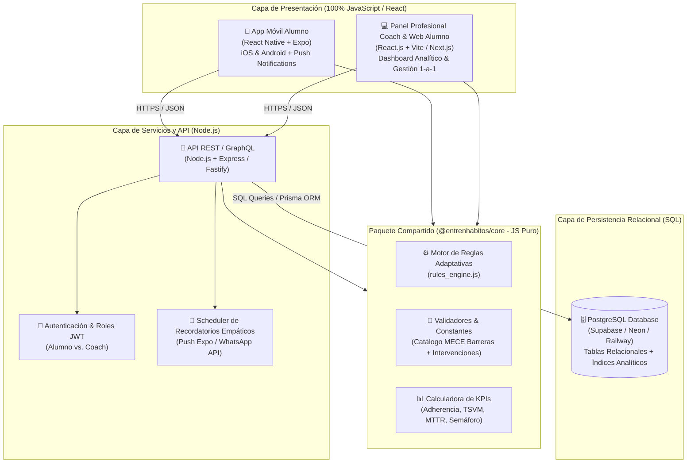
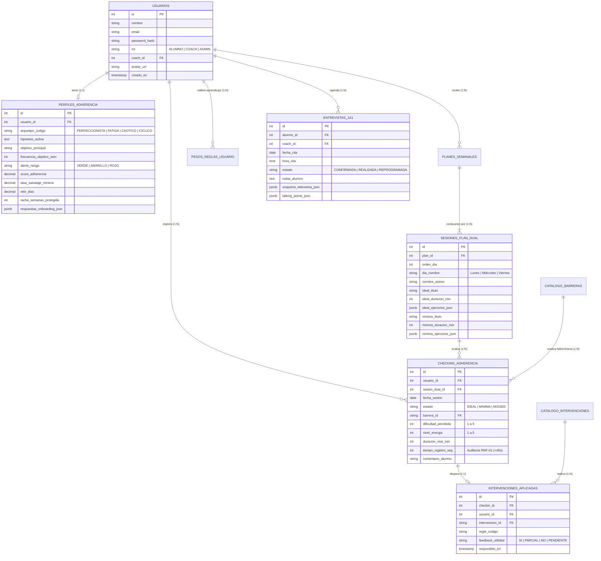

# R6 — Arquitectura Técnica de Producción: JavaScript, React / React Native y Base de Datos SQL

**Proyecto:** Entrenhábitos — Plataforma de Adherencia y Formación de Hábitos en el Gimnasio  
**Versión:** 1.0  
**Fecha:** Noviembre 2026  
**Autor:** Dirección de Proyecto & Arquitectura de Software  
**Estado:** Aprobado como Hoja de Ruta Técnica Principal  

---

## 1. Resumen Ejecutivo y Viabilidad Técnica

El objetivo de este documento es definir la arquitectura definitiva de producción para **Entrenhábitos**, basada en la decisión estratégica de construir todo el ecosistema utilizando **JavaScript (ES6+ / TypeScript)** en el frontend y backend (**React.js** para Web, **React Native** para App Móvil y **Node.js** para API), respaldado por un motor de **Base de Datos Relacional SQL (PostgreSQL)**.

### ¿Es viable y recomendable esta arquitectura?
**Sí, es 100% viable y representa la arquitectura óptima para el modelo de negocio del cliente.**

1. **Unificación total del lenguaje (Full-Stack JavaScript):**
   - El motor de inferencia conductual (`RulesEngine`), los catálogos de barreras (`B1_TIME` a `B5_GUILT_ALL_OR_NOTHING`), las 7 intervenciones (`INT-01` a `INT-07`) y el cálculo de métricas ($MTTR$, $TSVM$, Semáforo de Riesgo) se escriben **una sola vez en JavaScript** y se comparten sin fricción entre la aplicación móvil del alumno, el panel web del entrenador y el servidor backend.
2. **Separación ergonómica por rol (Mobile-First para el Alumno, Desktop-First para el Entrenador):**
   - **El Alumno (`React Native + Expo`)** interactúa con el sistema en contextos de alta fricción (saliendo tarde de trabajar, en el vestuario del gimnasio o cansado por la noche). Necesita una app nativa en su teléfono con notificaciones *push*, acceso en 1 toque al *"Escudo Día Difícil (15-20 min)"* y un check-in táctil que tome menos de 45 segundos.
   - **El Entrenador (`React.js Web`)** gestiona una cohorte de 20 a 200+ asesorados. Necesita una pantalla amplia de escritorio para filtrar el semáforo de abandono, auditar el historial de check-ins, preparar entrevistas 1-a-1 con *talking points* automáticos y ajustar planes duales.
3. **Superioridad del Modelo Relacional SQL para Telemetría Conductual:**
   - A diferencia de aplicaciones de contenido no estructurado, **Entrenhábitos es un sistema transaccional y analítico de causa-efecto**. Cada registro diario vincula a un *Alumno* con una *Sesión Planificada*, una *Modalidad Ejecutada (Ideal vs. Mínima)*, una *Barrera Declarada*, una *Intervención Disparada* y una *Validación de Utilidad (`¿Te sirvió?`)*.
   - **SQL (PostgreSQL)** garantiza integridad referencial estricta y permite ejecutar consultas analíticas complejas (rachas con *Window Functions*, tasas de salvataje por cohorte, correlación entre barreras y horarios) en milisegundos.

---

## 2. Diagrama de Arquitectura del Ecosistema (Monorepo JS + SQL)



---

## 3. Stack Tecnológico Detallado por Capa

| Capa del Sistema | Tecnología Principal | Herramientas Complementarias | Justificación para Entrenhábitos |
| :--- | :--- | :--- | :--- |
| **App Móvil (Alumno)** | **React Native (con Expo)** | `Expo Router`, `Expo Notifications`, `React Native Reanimated`, `AsyncStorage` | Permite compilar para **Android e iOS** desde una única base de código JavaScript. `Reanimated` habilita micro-interacciones fluidas a 60fps para el check-in y el escudo de versión mínima. |
| **Panel Web (Coach + Alumno Web)** | **React.js (Vite o Next.js)** | `React Router`, `TanStack Query`, `Tailwind CSS` o CSS Modules, `Lucide Icons` | Ideal para la tabla de cohorte en tiempo real, filtros por semáforo de riesgo (Verde/Amarillo/Rojo), gráficos de continuidad y preparación de sesiones 1-a-1. |
| **Núcleo Compartido (`shared/`)** | **JavaScript ES6+ / TypeScript** | Módulos ESM (`rules_engine.js`, `validators.js`) | Evita duplicar la lógica del método del cliente: la misma función que calcula el diagnóstico en el Onboarding o el $MTTR$ corre tanto en el celular como en el servidor. |
| **Backend & API** | **Node.js** | `Express` o `Fastify`, `Prisma ORM` (o `Drizzle ORM`), `Zod` | Mismo lenguaje (JavaScript) que el frontend. `Prisma/Drizzle` mapea las tablas SQL directamente a objetos JavaScript tipados y seguros. |
| **Base de Datos Relacional** | **PostgreSQL (SQL)** | **Supabase**, **Neon.tech** o **Railway** | Motor SQL estándar de la industria. Soporta claves foráneas, transacciones ACID, funciones de ventana (`LAG`, `LEAD` para calcular el $MTTR$) y columnas `JSONB` híbridas para listas de ejercicios. |

---

## 4. Diseño del Esquema Relacional SQL (DER y Script DDL)

### 4.1 Diagrama Entidad-Relación (DER)



---

### 4.2 Script SQL de Creación de Tablas (DDL compatible con PostgreSQL)

Este esquema SQL traslada de forma exacta las entidades que ya funcionan en nuestro prototipo interactivo ([js/demo_data.js](file:///c:/Users/lauta/Proyectos/PROYECTO%20ENTRENHABITOS/js/demo_data.js) y [js/store.js](file:///c:/Users/lauta/Proyectos/PROYECTO%20ENTRENHABITOS/js/store.js)):

```sql
-- ============================================================================
-- ENTRENHÁBITOS — ESQUEMA RELACIONAL SQL (PostgreSQL 15+)
-- ============================================================================

-- 1. TABLA DE USUARIOS (Alumnos y Entrenadores)
CREATE TABLE usuarios (
    id SERIAL PRIMARY KEY,
    codigo_externo VARCHAR(50) UNIQUE, -- ej: 'alumno_martin'
    nombre VARCHAR(120) NOT NULL,
    email VARCHAR(150) UNIQUE NOT NULL,
    password_hash VARCHAR(255) NOT NULL,
    rol VARCHAR(20) NOT NULL CHECK (rol IN ('ALUMNO', 'COACH', 'ADMIN')),
    edad INT,
    profesion VARCHAR(120),
    avatar VARCHAR(30) DEFAULT '👤',
    coach_asignado_id INT REFERENCES usuarios(id) ON DELETE SET NULL,
    activo BOOLEAN DEFAULT TRUE,
    creado_en TIMESTAMP WITH TIME ZONE DEFAULT CURRENT_TIMESTAMP
);

-- 2. CATÁLOGO OFICIAL DE BARRERAS CONDUCTUALES (Taxonomía MECE B1 a B5)
CREATE TABLE catalogo_barreras (
    id VARCHAR(40) PRIMARY KEY, -- ej: 'B1_TIME', 'B2_ENERGY'
    codigo_corto VARCHAR(10) NOT NULL,
    nombre VARCHAR(100) NOT NULL,
    categoria VARCHAR(60) NOT NULL,
    descripcion TEXT NOT NULL,
    icono VARCHAR(15)
);

-- 3. CATÁLOGO OFICIAL DE INTERVENCIONES ADAPTATIVAS (INT-01 a INT-07)
CREATE TABLE catalogo_intervenciones (
    id VARCHAR(30) PRIMARY KEY, -- ej: 'INT_01'
    codigo VARCHAR(15) NOT NULL, -- ej: 'INT-01'
    titulo VARCHAR(140) NOT NULL,
    tipo VARCHAR(50) NOT NULL,
    duracion_estimada_min INT,
    descripcion TEXT NOT NULL,
    fundamento_conductual TEXT NOT NULL,
    pasos_accion_json JSONB NOT NULL DEFAULT '[]'::jsonb
);

-- 4. PERFILES CONDUCTUALES Y DIAGNÓSTICO DE ADHERENCIA (Módulo 1)
CREATE TABLE perfiles_adherencia (
    id SERIAL PRIMARY KEY,
    usuario_id INT UNIQUE NOT NULL REFERENCES usuarios(id) ON DELETE CASCADE,
    arquetipo_key VARCHAR(40) NOT NULL, -- 'PERFECCIONISTA', 'FATIGA_COGNITIVA', etc.
    arquetipo_nombre VARCHAR(100) NOT NULL,
    hipotesis_activa TEXT NOT NULL,
    estrategia_innegociable TEXT,
    barrera_predominante_id VARCHAR(40) REFERENCES catalogo_barreras(id),
    frecuencia_objetivo_sem INT NOT NULL DEFAULT 3 CHECK (frecuencia_objetivo_sem BETWEEN 1 AND 7),
    alerta_riesgo VARCHAR(15) NOT NULL DEFAULT 'VERDE' CHECK (alerta_riesgo IN ('VERDE', 'AMARILLO', 'ROJO')),
    score_adherencia NUMERIC(5,2) DEFAULT 100.00,
    tasa_salvataje_minima NUMERIC(5,2) DEFAULT 0.00,
    mttr_dias NUMERIC(4,2) DEFAULT 1.00,
    racha_actual_semanas INT DEFAULT 1,
    respuestas_onboarding_json JSONB DEFAULT '{}'::jsonb,
    actualizado_en TIMESTAMP WITH TIME ZONE DEFAULT CURRENT_TIMESTAMP
);

-- 5. PLANES SEMANALES Y SESIONES CON ESTRUCTURA DUAL (Módulo 2)
CREATE TABLE planes_semanales (
    id SERIAL PRIMARY KEY,
    usuario_id INT NOT NULL REFERENCES usuarios(id) ON DELETE CASCADE,
    frecuencia_objetivo INT NOT NULL DEFAULT 3,
    vigente BOOLEAN DEFAULT TRUE,
    creado_en TIMESTAMP WITH TIME ZONE DEFAULT CURRENT_TIMESTAMP
);

CREATE TABLE sesiones_plan_dual (
    id SERIAL PRIMARY KEY,
    plan_id INT NOT NULL REFERENCES planes_semanales(id) ON DELETE CASCADE,
    orden_dia INT NOT NULL,
    dia_semana VARCHAR(20) NOT NULL, -- 'Lunes', 'Miércoles', 'Viernes'
    nombre_sesion VARCHAR(100) NOT NULL,
    -- Variante A: Versión Ideal (45-60 min)
    ideal_titulo VARCHAR(120) NOT NULL,
    ideal_duracion_min INT NOT NULL CHECK (ideal_duracion_min BETWEEN 30 AND 120),
    ideal_ejercicios_json JSONB NOT NULL,
    -- Variante B: Versión Mínima / "Día Difícil" (15-20 min)
    minima_titulo VARCHAR(120) NOT NULL,
    minima_duracion_min INT NOT NULL CHECK (minima_duracion_min BETWEEN 10 AND 30),
    minima_ejercicios_json JSONB NOT NULL
);

-- 6. CHECK-INS DIARIOS DE ADHERENCIA (< 1 MINUTO) (Módulo 3)
CREATE TABLE checkins_adherencia (
    id SERIAL PRIMARY KEY,
    usuario_id INT NOT NULL REFERENCES usuarios(id) ON DELETE CASCADE,
    sesion_dual_id INT REFERENCES sesiones_plan_dual(id) ON DELETE SET NULL,
    fecha DATE NOT NULL DEFAULT CURRENT_DATE,
    estado VARCHAR(20) NOT NULL CHECK (estado IN ('ideal', 'minima', 'missed')),
    barrera_id VARCHAR(40) REFERENCES catalogo_barreras(id),
    dificultad INT CHECK (dificultad BETWEEN 1 AND 5),
    energia INT CHECK (energia BETWEEN 1 AND 5),
    tiempo_real_min INT NOT NULL DEFAULT 0,
    tiempo_registro_seg INT NOT NULL DEFAULT 20, -- Telemetría UX (< 45s)
    notas VARCHAR(280),
    creado_en TIMESTAMP WITH TIME ZONE DEFAULT CURRENT_TIMESTAMP,
    -- Regla de negocio: Si el estado es 'minima' o 'missed', la barrera es obligatoria
    CONSTRAINT chk_barrera_obligatoria CHECK (
        estado = 'ideal' OR barrera_id IS NOT NULL
    )
);

-- 7. HISTORIAL DE INTERVENCIONES ADAPTATIVAS Y BUCLE DE VALIDACIÓN (Módulo 4)
CREATE TABLE intervenciones_aplicadas (
    id SERIAL PRIMARY KEY,
    checkin_id INT UNIQUE NOT NULL REFERENCES checkins_adherencia(id) ON DELETE CASCADE,
    usuario_id INT NOT NULL REFERENCES usuarios(id) ON DELETE CASCADE,
    intervencion_id VARCHAR(30) NOT NULL REFERENCES catalogo_intervenciones(id),
    regla_disparada VARCHAR(40) NOT NULL, -- ej: 'RULE_TIME_01'
    prioridad VARCHAR(20) DEFAULT 'high',
    feedback_alumno VARCHAR(15) CHECK (feedback_alumno IN ('si', 'parcial', 'no')),
    evaluada_en TIMESTAMP WITH TIME ZONE
);

-- 8. PESOS DE APRENDIZAJE ADAPTATIVO POR USUARIO (Personalización Bayesiana)
CREATE TABLE pesos_intervenciones_usuario (
    usuario_id INT NOT NULL REFERENCES usuarios(id) ON DELETE CASCADE,
    intervencion_id VARCHAR(30) NOT NULL REFERENCES catalogo_intervenciones(id),
    peso_efectividad NUMERIC(4,2) NOT NULL DEFAULT 0.50 CHECK (peso_efectividad BETWEEN 0.10 AND 1.00),
    actualizado_en TIMESTAMP WITH TIME ZONE DEFAULT CURRENT_TIMESTAMP,
    PRIMARY KEY (usuario_id, intervencion_id)
);

-- 9. AGENDAMIENTO DE ENTREVISTAS 1-A-1 CON TELEMETRÍA PRECARGADA (Módulos 5 y 6)
CREATE TABLE entrevistas_1a1 (
    id SERIAL PRIMARY KEY,
    alumno_id INT NOT NULL REFERENCES usuarios(id) ON DELETE CASCADE,
    coach_id INT REFERENCES usuarios(id) ON DELETE SET NULL,
    fecha DATE NOT NULL,
    hora VARCHAR(10) NOT NULL,
    estado VARCHAR(20) DEFAULT 'confirmada' CHECK (estado IN ('confirmada', 'completada', 'cancelada')),
    notas_alumno TEXT,
    resumen_telemetrico_json JSONB NOT NULL,
    talking_points_sugeridos_json JSONB NOT NULL,
    creado_en TIMESTAMP WITH TIME ZONE DEFAULT CURRENT_TIMESTAMP
);

-- ÍNDICES PARA RENDIMIENTO EN EL PANEL DEL COACH
CREATE INDEX idx_checkins_usuario_fecha ON checkins_adherencia(usuario_id, fecha DESC);
CREATE INDEX idx_checkins_barrera ON checkins_adherencia(barrera_id);
CREATE INDEX idx_perfiles_riesgo ON perfiles_adherencia(alerta_riesgo);
```

---

## 5. Consultas SQL Clave que Potencian el Panel del Coach

Una de las mayores ventajas de elegir **SQL** es que los indicadores complejos del método Entrenhábitos se resuelven directamente en el motor de base de datos:

### A. Cálculo de Adherencia Real y Tasa de Salvataje por Versión Mínima ($TSVM$)
```sql
SELECT 
    u.id AS alumno_id,
    u.nombre,
    COUNT(c.id) AS total_sesiones_evaluadas,
    COUNT(*) FILTER (WHERE c.estado IN ('ideal', 'minima')) AS sesiones_cumplidas,
    ROUND(
        100.0 * COUNT(*) FILTER (WHERE c.estado IN ('ideal', 'minima')) / NULLIF(COUNT(c.id), 0),
        1
    ) AS tasa_adherencia_pct,
    ROUND(
        100.0 * COUNT(*) FILTER (WHERE c.estado = 'minima') / NULLIF(COUNT(*) FILTER (WHERE c.estado IN ('ideal', 'minima')), 0),
        1
    ) AS tasa_salvataje_minima_pct
FROM usuarios u
LEFT JOIN checkins_adherencia c ON c.usuario_id = u.id
WHERE u.rol = 'ALUMNO'
GROUP BY u.id, u.nombre;
```

### B. Ranking de Barreras Recurrentes e Intervenciones que Mejor Funcionaron
```sql
SELECT 
    b.nombre AS barrera,
    COUNT(c.id) AS veces_reportada,
    i.titulo AS intervencion_recomendada,
    COUNT(*) FILTER (WHERE ia.feedback_alumno = 'si') AS veces_exitosa
FROM checkins_adherencia c
JOIN catalogo_barreras b ON b.id = c.barrera_id
LEFT JOIN intervenciones_aplicadas ia ON ia.checkin_id = c.id
LEFT JOIN catalogo_intervenciones i ON i.id = ia.intervencion_id
WHERE c.usuario_id = $1
GROUP BY b.nombre, i.titulo
ORDER BY veces_reportada DESC;
```

---

## 6. Estrategia de Migración desde el Prototipo Actual hacia React + React Native + SQL

El prototipo interactivo actual fue diseñado siguiendo una **arquitectura desacoplada por capas** que facilita su transición directa al stack definitivo sin desperdiciar código:

1. **Paso 1 — Reutilización directa del Motor de Reglas (`js/rules_engine.js` y `js/demo_data.js`):**
   - Los archivos [js/rules_engine.js](file:///c:/Users/lauta/Proyectos/PROYECTO%20ENTRENHABITOS/js/rules_engine.js) y [js/demo_data.js](file:///c:/Users/lauta/Proyectos/PROYECTO%20ENTRENHABITOS/js/demo_data.js) ya son módulos JavaScript ES6 puros sin dependencia del DOM. Se copian directamente a la carpeta `packages/core/` del proyecto React / React Native.
2. **Paso 2 — Reemplazo de `localStorage` (`js/store.js`) por llamadas a API + SQL:**
   - En lugar de guardar en `localStorage`, los métodos `submitCheckIn()`, `completeOnboarding()`, `evaluateIntervention()` y `scheduleInterview()` de [js/store.js](file:///c:/Users/lauta/Proyectos/PROYECTO%20ENTRENHABITOS/js/store.js) pasarán a realizar peticiones `fetch` / `TanStack Query` contra los endpoints de Node.js + PostgreSQL (`/api/checkins`, `/api/onboarding`, `/api/interviews`).
3. **Paso 3 — Conversión de Vistas a Componentes React:**
   - La vista `#view-student` (con sus 5 pestañas móviles) se convierte en las 5 pantallas de `Expo Router` en **React Native**.
   - La vista `#view-coach` (tabla de cohorte, expediente y generador de *talking points*) se convierte en el Dashboard administrativo en **React.js Web**.
